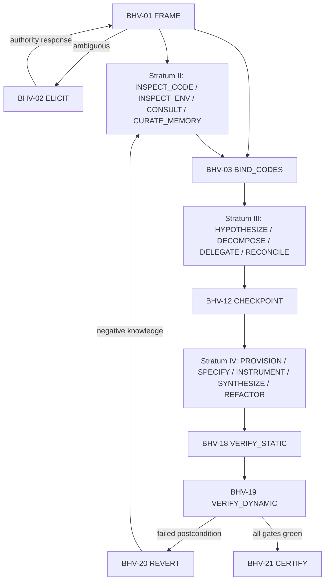

# Pillar 1 — Complete Agent Behavior Basis ($F_8 = 21$)

## 1. Purpose & Basis Invariants

Pillar 1 defines an atomic behavioral basis $\mathcal{B}$ for coding agents satisfying two hard structural invariants:

1. **Completeness (Graph Span):** Every software engineering or coding-agent task must be representable as a directed graph $G = (V, E, \ell, v_{\text{entry}})$ with node labeling $\ell: V \to \mathcal{B}$ over a non-empty subset of $\mathcal{B}$.
2. **Fibonacci Cardinality:** $|\mathcal{B}| \in \mathcal{F}$, specifically $|\mathcal{B}| = F_8 = 21$.

### Why Behaviors Are Neither Tools Nor Workflows
- **Not tools:** `grep`, `read_file`, `git`, `pytest`, and IDE MCP calls are sensors/actuators. Multiple behaviors can invoke the same tool under distinct epistemic contracts, and one behavior can switch tools without changing its state-transition semantics.
- **Not workflows:** "Debug defect", "Refactor module", and "Security review" are composite subgraphs over $\mathcal{B}$, not basis elements.
- **Why $21$ ($F_8$):** At $13$ ($F_7$), distinct statutory contracts (`SPECIFY`, `SYNTHESIZE`, `REFACTOR`) collapse into generic mutation, making graph-level enforcement of order-of-operations impossible. At $34$ ($F_9$), sensor/actuator modalities begin leaking into the basis. At $21$, every node carries a distinct epistemic or statutory postcondition.

---

## 2. Agent Execution State Algebra

Every atomic behavior is a typed transition over the product state space:

$$\Sigma = \mathcal{P} \times \mathcal{W} \times \Omega \times \mathcal{E}$$

| Domain | Enum (`StateDomain`) | State Held |
| :--- | :--- | :--- |
| $\mathcal{P}$ | `problem` | Framed objective, authority resolutions, bound building codes, decomposed sub-goals. |
| $\mathcal{W}$ | `world_model` | Grounded codebase/env/external facts, causal hypotheses, negative knowledge (falsified paths), active delegations. |
| $\Omega$ | `workspace` | Checkpoints/snapshots, dependencies/substrate, contracts/types, test harnesses, implementation & AST mutations. |
| $\mathcal{E}$ | `evidence` | Static/dynamic verification verdicts, rollback logs, and final code-compliance certification seals. |

---

## 3. Canonical $21$-Behavior Specification (`BHV-01` .. `BHV-21`)

| Code | Kind | Stratum | Reads | Writes | Workspace Effect | Core Postcondition |
| :--- | :--- | :--- | :--- | :--- | :--- | :--- |
| `BHV-01` | `frame` | `governance` | $\mathcal{P}, \mathcal{W}$ | $\mathcal{P}$ | `none` | Objective, boundaries, and ambiguities are explicitly enumerated. |
| `BHV-02` | `elicit` | `governance` | $\mathcal{P}, \mathcal{W}$ | $\mathcal{P}$ | `none` | Ambiguity prompt or permission escalation emitted across authority boundary. |
| `BHV-03` | `bind_codes` | `governance` | $\mathcal{P}, \mathcal{W}$ | $\mathcal{P}$ | `none` | Applicable building codes and acceptance invariants bound to scope. |
| `BHV-04` | `inspect_code` | `epistemic` | $\mathcal{P}, \Omega$ | $\mathcal{W}$ | `none` | Grounded lexical/AST/dependency facts recorded without mutation. |
| `BHV-05` | `inspect_env` | `epistemic` | $\mathcal{P}, \Omega$ | $\mathcal{W}$ | `none` | Toolchain, package, VCS, log, or live schema facts recorded. |
| `BHV-06` | `consult` | `epistemic` | $\mathcal{P}, \mathcal{W}$ | $\mathcal{W}$ | `none` | Authoritative JBC provisions, confined workspace docs, and local polyglot package APIs (`py:`/`npm:`/`crate:`/`go:`) anchored offline with citations. |
| `BHV-07` | `curate_memory` | `epistemic` | $\mathcal{W}, \mathcal{E}$ | $\mathcal{W}$ | `none` | Context compacted while retaining active invariants and negations. |
| `BHV-08` | `hypothesize` | `topology` | $\mathcal{P}, \mathcal{W}, \mathcal{E}$ | $\mathcal{W}$ | `none` | Falsifiable causal model and discriminating experiment recorded. |
| `BHV-09` | `decompose` | `topology` | $\mathcal{P}, \mathcal{W}$ | $\mathcal{P}$ | `none` | Sub-goal DAG defined with explicit interfaces and disjoint write scopes. |
| `BHV-10` | `delegate` | `topology` | $\mathcal{P}, \mathcal{W}$ | $\mathcal{W}$ | `none` | Isolated worker tasks dispatched and tracked for reconciliation. |
| `BHV-11` | `reconcile` | `topology` | $\mathcal{P}, \mathcal{W}, \mathcal{E}$ | $\mathcal{W}, \mathcal{E}$ | `none` | Delegated branches synchronized and boundary conflicts resolved. |
| `BHV-12` | `checkpoint` | `mutation` | $\Omega$ | $\Omega, \mathcal{E}$ | `checkpoint` | Deterministic restore handle created for atomic rollback. |
| `BHV-13` | `provision` | `mutation` | $\mathcal{P}, \mathcal{W}, \Omega$ | $\Omega$ | `mutate` | Dependencies, lockfiles, or build substrate updated. |
| `BHV-14` | `specify` | `mutation` | $\mathcal{P}, \mathcal{W}, \Omega$ | $\Omega$ | `mutate` | Formal types, schemas, interfaces, and contracts encoded. |
| `BHV-15` | `instrument` | `mutation` | $\mathcal{P}, \mathcal{W}, \Omega$ | $\Omega$ | `mutate` | Executable tests, property generators, or repro probes authored. |
| `BHV-16` | `synthesize` | `mutation` | $\mathcal{P}, \mathcal{W}, \Omega$ | $\Omega$ | `mutate` | Implementation artifacts constructed/mutated against contracts. |
| `BHV-17` | `refactor` | `mutation` | $\mathcal{P}, \mathcal{W}, \Omega$ | $\Omega$ | `mutate` | Structure transformed while preserving observable semantics. |
| `BHV-18` | `verify_static` | `verification` | $\mathcal{P}, \Omega$ | $\mathcal{E}$ | `none` | Syntax, strict types, AST, and static code gates evaluated. |
| `BHV-19` | `verify_dynamic` | `verification` | $\mathcal{P}, \Omega$ | $\mathcal{E}$ | `none` | Runtime, property, and boundary suites evaluated against postconditions. |
| `BHV-20` | `revert` | `verification` | $\Omega, \mathcal{E}$ | $\Omega, \mathcal{W}, \mathcal{E}$ | `restore` | Workspace restored to checkpoint; failed hypothesis recorded in $\mathcal{W}$. |
| `BHV-21` | `certify` | `verification` | $\mathcal{P}, \mathcal{W}, \mathcal{E}$ | $\Omega, \mathcal{E}$ | `seal` | Evidence audited against all bound codes; deliverable sealed. |

---

## 4. Structural & Monotone Dataflow Laws

Every `BehaviorGraph` (including cyclic debugging/retry graphs) is verified by `verify_behavior_graph()` across two layers:

### Layer A — Topological & Local Adjacency Laws
1. **Unique Entry at `FRAME`:** `entry_id` must have kind `FRAME` (`BHV-01`).
2. **Valid Terminal Sinks:** Every sink vertex ($\text{out-degree} = 0$) must be either `CERTIFY` (completed verified task) or `ELICIT` (suspended awaiting external authority). `CERTIFY` has strict out-degree $0$.
3. **Co-Reachability (No Trap Cycles):** Every vertex reachable from `entry_id` must have at least one directed path to a valid terminal sink.
4. **Authority Re-entry:** Any outgoing transition from `ELICIT` must enter `FRAME` so external responses are re-parsed and checked for contradictions.
5. **No Blind Stochastic Retry:** `REVERT` cannot transition directly to any Stratum IV mutation node; execution must pass through an epistemic, abductive, decomposition, or framing node first.
6. **No Direct Mutation-to-Certify Shortcuts:** No `WorkspaceEffect.MUTATE` node can transition directly to `CERTIFY`, `FRAME`, or `ELICIT`.

### Layer B — Kildall Fixed-Point Dataflow Invariants
Computed across all paths (including cycles) from `entry_id`:
- **`codes_bound` (MUST / $\wedge$):** Every path reaching `PROVISION`, `SPECIFY`, `INSTRUMENT`, `SYNTHESIZE`, `REFACTOR`, `DELEGATE`, or `CERTIFY` must be dominated by `BIND_CODES`.
- **`checkpoint_active` (MUST / $\wedge$):** Every path reaching any `WorkspaceEffect.MUTATE` node or `REVERT` must be dominated by `CHECKPOINT`.
- **`may_be_dirty_static` (MAY / $\vee$):** Set by `SPECIFY`, `INSTRUMENT`, `SYNTHESIZE`, `REFACTOR`; cleared only by `VERIFY_STATIC` or `REVERT`. Must be `False` at `CERTIFY`.
- **`may_be_dirty_dynamic` (MAY / $\vee$):** Set by `PROVISION`, `INSTRUMENT`, `SYNTHESIZE`, `REFACTOR`; cleared only by `VERIFY_DYNAMIC` or `REVERT`. Must be `False` at `CERTIFY`.
- **`unreconciled_delegation` (MAY / $\vee$):** Set by `DELEGATE`; cleared by `RECONCILE`. Must be `False` at `CERTIFY`.

---

## 5. Reference Stratum Flow Topology

