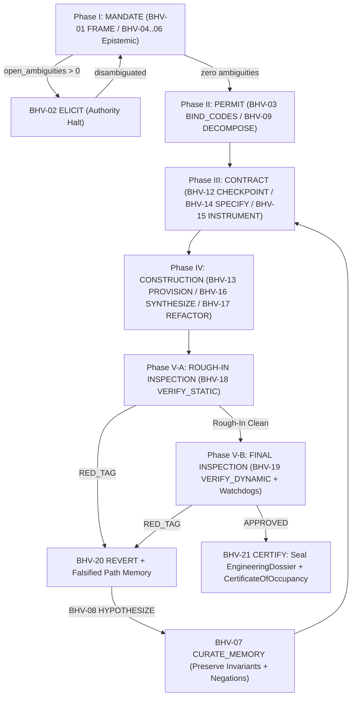

# Pillar 3B — Permit-and-Contract Engineering (`PCE`)

## 1. Foundational Definition

**Permit-and-Contract Engineering (`PCE`)** is `jezz`'s formal software engineering methodology built atop Pillar 1's 21-behavior state algebra (`BHV-01`..`BHV-21`) and Pillar 2's 32-provision Software Building Code (`JBC` Edition 1.3 across Python, TypeScript/TSX, Rust, and Go).

`PCE` rejects both Agile ceremony theatre (user stories, sprints, story points, backlog grooming) and unverified prose "Spec-Driven Development" (`spec.md` / `plan.md` / `tasks.md`). Instead, `PCE` governs software construction the way civil and electrical engineering govern physical structures—through two machine-checkable instruments and an independent inspection gate:

1. **The Permit (`CodePermit` over `JBC`):** Defines *universal structural and life-safety legality*—type/signature breakers, fault isolation, injection/taint containment, dynamic path anchoring (`JBC-SEC-006`), termination and memory envelopes, cognitive/dispatch simplicity, single-duty class cohesion (`LCOM4 == 1`), ecosystem manifest grounding, and anti-theatre verification. No mutation may occur before a `CodePermit` is bound (`BHV-03 BIND_CODES`).
2. **The Contract (`EngineeringMandate` + Compiled Invariants):** Defines *unit-specific functional obligations*—encoded exclusively as compiled schemas (`STRICT_FROZEN_CONFIG`, Zod `.strict()`, `#[serde(deny_unknown_fields)]`, validated Go structs), runtime signature breakers (`@jezz_callable`, guard clauses, `.Validate()`), relational pre/postconditions (`@icontract.require` / `@icontract.ensure`), and executable property/falsification suites (`hypothesis` / `pytest`, `vitest`, `cargo test`, `go test`). Every `DomainInvariant` in a mandate must resolve to an AST/CST-verified symbol across workspace `InspectedUnit`s.
3. **The Building Inspector & Occupancy Seal (`BuildingInspector` $\to$ `CertificateOfOccupancy`):** An automated, deterministic auditor that evaluates both Rough-In (`BHV-18 VERIFY_STATIC`) and Final Inspection (`BHV-19 VERIFY_DYNAMIC` + runtime/memory watchdogs), issuing either a **Stop-Work `RED_TAG`** (forcing `BHV-20 REVERT` + `BHV-08 HYPOTHESIZE` + `BHV-07 CURATE_MEMORY` negative-knowledge retention) or a SHA-256-sealed **`CertificateOfOccupancy`** (`BHV-21 CERTIFY`).

---

## 2. The Five Statutory Phases of `PCE`

### Phase 0 / I — `CHARTER & MANDATE` (Reality-Probed Intake, Framing, & Authority Disambiguation)
- **Behaviors:** `BHV-05 INSPECT_ENV`, `BHV-01 FRAME`, `BHV-04 INSPECT_CODE`, `BHV-06 CONSULT`, `BHV-02 ELICIT`.
- **Artifacts:** Phased `ProjectCharter` (`jezz charter`, `pce_start_intake` / `pce_seal_charter`) for multi-slice / greenfield visions, and immutable `EngineeringMandate` per atomic slice.
- **Hard Laws:**
  1. **Empirical Reality Probe & 3-Axis Completeness Gate (`charter.py`):** Before interviewing a user or synthesizing permits on greenfield/multi-slice visions, `probe_workspace_reality` captures workspace manifests, languages, binaries, and installed SDKs into a SHA-256-sealed `RealityProbeEvidence`. `seal_project_charter` refuses to seal until non-theatre `AxisResolution`s resolve all three mandatory axes (`domain_ontology`, `hazard_mutation_policy`, `scope_and_exclusions`), explicit `scope_exclusions` are declared, and `HazardMutationPolicy` satisfies active `EXTERNAL_BOUNDARY` / `SENSITIVE_CONTEXT` triggers—compiling a topologically ordered `EngineeringMandate` DAG (`MandateDependency`).
  2. **Anti-Agile / Anti-Weasel Grammar:** Rejects persona user stories (`"As a <role>, I want..., so that..."`), Agile ceremony fields (story points, sprints), Markdown checkbox lists, and non-normative weasel modals (`"should"`, `"ideally"`, `"maybe"`, `"try to"`, `"nice to have"`).
  3. **Mandatory Authority Escalation:** If `open_ambiguities` is non-empty, autonomous progression to Phase II is **blocked**; execution must terminate at `BHV-02 ELICIT` rather than silently inventing requirements.
  4. **Disjoint Module Write Scopes:** Every target file belongs to at most one `ModuleWriteScope` (`s_i.owned_files & s_j.owned_files == ∅` for $i \neq j$), preventing multi-worker write collisions before decomposition begins.

### Phase II — `PERMIT` (Statutory Code Binding & Lot-Line Shear Pre-Flight)
- **Behaviors:** `BHV-03 BIND_CODES`, `BHV-08 HYPOTHESIZE`, `BHV-09 DECOMPOSE`.
- **Artifacts:** `CodePermit` binding `CodeTrigger.UNIVERSAL` plus scope hazard triggers (`CONSTRAINED_DOMAIN`, `EXTERNAL_BOUNDARY`, `SENSITIVE_CONTEXT`, `VERIFICATION_SUITE`) and any pre-authorized `CodeVariance` grants obtained via `ELICIT`, paired with `LotLineAssessment` (`lot_line.py`, `jbc_assess_lot_line`) and optional target `BlueprintGraph` ($B^* = B_0 \oplus \Delta B$).
- **Lot-Line Shear Law:** During `BHV-09 DECOMPOSE`, `assess_mandate_lot_line` evaluates `JBC-COG-006` floorplate headroom, **Public-API Sufficiency**, **Dependency Closure Shear (`CRP`)**, and **`CodeTrigger` Escalation**, classifying slices into `IN_PACKAGE` (sparing inward-facing Hexagonal ports with core fan-in), `WORKSPACE_COMPARTMENT`, or `LOT_LINE_SPLIT` (routing unapproved package/repo splits to `BHV-02 ELICIT` prior to workspace mutation).

### Phase III — `CONTRACT` (Executable Specification & Falsification Harness)
- **Behaviors:** `BHV-12 CHECKPOINT`, `BHV-14 SPECIFY`, `BHV-15 INSTRUMENT`.
- **Artifacts:** Compiled boundary schemas, `@jezz_callable` / runtime signature breakers, `@icontract` pre/postconditions, and property/falsification suites inside workspace `InspectedUnit`s (`.py`, `.ts`/`.tsx`, `.rs`, `.go`).
- **Hard Laws:**
  1. Every `DomainInvariant` in `EngineeringMandate` declares an explicit `verification_symbol` (`ClassName`, `TypeName`, `callable_name`, or `test_*` symbol) that must resolve in the parsed AST/CST of the workspace.
  2. Vacuous contracts (`lambda x: True`, `@ensure` ignoring `result`, `assert(true)`, `assert!(true)`) and vacuous tests (`assert True`, zero-assertion smoke tests) are immediately red-tagged by `JBC-DBC-001` and `JBC-VRF-001`.

### Phase IV — `CONSTRUCTION` (Bounded Synthesis & Refactoring)
- **Behaviors:** `BHV-13 PROVISION`, `BHV-16 SYNTHESIZE`, `BHV-17 REFACTOR`, `BHV-10 DELEGATE`, `BHV-11 RECONCILE`.
- **Hard Laws:**
  1. **Write-Scope Confinement:** Mutations outside `mandate.authorized_files()` trigger an immediate `UNDECLARED_WRITE_MUTATION` dossier violation.
  2. **Structural & Resource Envelopes:** All synthesized code is constrained by `@jezz_callable` / boundary breakers (`JBC-DBC-004`), bounded types (`JBC-DBC-005`), dynamic path anchoring (`JBC-SEC-006`), `LoopBudget`/`RecursionBudget` termination (`JBC-FLT-004`), `MappingProxyType` / `match` / `switch` dispatch tables (`JBC-COG-004`), and single-duty `LCOM4 == 1` types (`JBC-COG-005`).

### Phase V — `OCCUPANCY` (Rough-In Inspection, Final Inspection, & Dossier Seal)
- **Behaviors:** `BHV-18 VERIFY_STATIC`, `BHV-19 VERIFY_DYNAMIC`, `BHV-20 REVERT`, `BHV-08 HYPOTHESIZE`, `BHV-07 CURATE_MEMORY`, `BHV-21 CERTIFY`.
- **Formal Occupancy Relation ($\mathcal{I} \models_{\text{PCE}} \mathcal{M}$):**
  `audit_pce_dossier(dossier, units)` certifies `OCCUPANCY` over workspace `InspectedUnit`s (`SourceUnit | PolyglotUnit`) if and only if **all seven** conditions hold simultaneously:
  1. **Zero Open Ambiguities:** `dossier.mandate.open_ambiguities == ()`.
  2. **Valid Behavioral Execution Graph:** `verify_behavior_graph(dossier.behavior_graph).is_valid is True` (entry at `FRAME`, `BIND_CODES` & `CHECKPOINT` dominance, static & dynamic dirty bits cleared before `CERTIFY`, all `DELEGATE` branches reconciled).
  3. **Contract-Before-Synthesis Ordering:** Any task graph executing `SYNTHESIZE` on a mandate with invariants includes contract/instrumentation verification symbols grounded in the workspace AST/CST.
  4. **Write-Scope Confinement:** `dossier.mutated_files <= dossier.mandate.authorized_files()`.
  5. **100% Symbol-Grounded Invariants:** Every `inv.verification_symbol` in `dossier.mandate.invariants` resolves to a compiled type, callable, or test symbol in `units` (eliminating floating prose specs across `.py`, `.ts`/`.tsx`, `.rs`, and `.go`).
  6. **Building-Code & Dual-Digest Seal Integrity:** `dossier.inspection_report.is_occupiable is True`, `dossier.permit.bound_code_ids <= dossier.inspection_report.effective_code_ids`, `dossier.certificate.verify_seal() is True`, `dossier.certificate.artifact_digest == compute_units_digest(digest_units)`, and (when sealed) `dossier.certificate.blueprint_netlist_digest == extract_blueprint(digest_units).netlist_digest`.
  7. **Coarse-Grained Target Schematic `LVS` Equivalence (`BLUEPRINT_LVS_MISMATCH`):** Whenever `dossier.target_blueprint` is present, `verify_blueprint_lvs(actual_blueprint, dossier.target_blueprint).is_lvs_clean is True` (`0` `OPEN_CIRCUIT` or `SHORT_CIRCUIT` boundary defects across room walls, perimeter ports, cross-room buses, external risers, and invariant pins, while leaving interior room helpers unconstrained).

---

## 3. Verification Topology Bifurcation: Defect Repair (`RED -> GREEN`) vs. Greenfield (`Contract + Property-First`)

Controlled empirical software-engineering studies distinguish observational reports confounded by test presence (Nagappan et al., 2008) from controlled experiments isolating Test-First sequencing against Iterative Test-Last (`ITL`) development (Rafique & Mišić, *IEEE TSE* 2013; Fucci et al., *IEEE TSE* 2017): **quality is driven by bounded, fine-grained slice granularity and executable invariants—not by baby-step Red-Green stub triangulation**, which stalls in local minima on constraint-heavy domains (Norvig vs. Jeffries) and multiplies subprocess/token overhead for coding agents while leaving single-LLM point-example blind spots unchallenged (`Track 21`: `12/12` SDD self-test pass vs. `33.3%` held-out property oracle escape).

`PCE` encodes this distinction directly in `src/jezz/behaviors/archetypes.py`:

| Task Class | Canonical Archetype (`archetypes.py`) | Statutory Execution Sequence | Formal Engineering Rationale |
| :--- | :--- | :--- | :--- |
| **Defect Repair / Regression** | `build_abductive_bugfix_graph` | `HYPOTHESIZE` $\to$ `INSTRUMENT` (`write_repro_test`) $\to$ **`VERIFY_DYNAMIC` (`confirm_repro_red`)** $\to$ `SYNTHESIZE` (`apply_candidate_fix`) $\to$ `VERIFY_STATIC` $\to$ `VERIFY_DYNAMIC` | **Mandatory `RED -> GREEN`:** Executing the reproduction test against unmodified `HEAD` proves **non-vacuity**—confirming the test actually fails on the defect rather than passing trivially (`JBC-VRF-001`). |
| **Greenfield & Renovation** | `build_greenfield_contract_first_graph` | `SPECIFY` (`specify_contracts`) $\to$ `INSTRUMENT` (`author_property_tests`) $\to$ `SYNTHESIZE` (`synthesize_module`) $\to$ `VERIFY_STATIC` $\to$ `VERIFY_DYNAMIC` | **Contract + Property-First:** Upfront domain schemas, `@jezz_callable` / `@icontract` predicates, and universally quantified property generators ($\forall x \in D: P(f(x))$) defeat correlated LLM point-example blind spots without wasteful Red-Green stub micro-cycles. |
