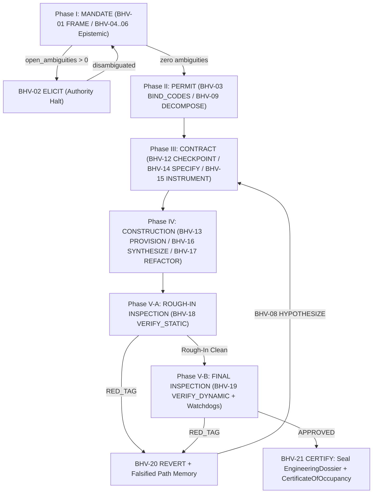

# Pillar 3B — Permit-and-Contract Engineering (`PCE`)

## 1. Foundational Definition

**Permit-and-Contract Engineering (`PCE`)** is `jezz`'s formal software engineering methodology built atop Pillar 1's 21-behavior state algebra (`BHV-01`..`BHV-21`) and Pillar 2's 30-provision Software Building Code (`JBC` Edition 1.1).

`PCE` rejects both Agile ceremony theatre (user stories, sprints, story points, backlog grooming) and unverified prose "Spec-Driven Development" (`spec.md` / `plan.md` / `tasks.md`). Instead, `PCE` governs software construction the way civil and electrical engineering govern physical structures—through two machine-checkable instruments and an independent inspection gate:

1. **The Permit (`CodePermit` over `JBC`):** Defines *universal structural and life-safety legality*—type/signature breakers, fault isolation, injection/taint containment, termination and memory envelopes, cognitive/dispatch simplicity, single-duty class cohesion (`LCOM4 == 1`), and anti-theatre verification. No mutation may occur before a `CodePermit` is bound (`BHV-03 BIND_CODES`).
2. **The Contract (`EngineeringMandate` + Compiled Invariants):** Defines *unit-specific functional obligations*—encoded exclusively as compiled Python types (`STRICT_FROZEN_CONFIG` schemas, bounded `Annotated` aliases), runtime signature breakers (`@jezz_callable`), relational pre/postconditions (`@icontract.require` / `@icontract.ensure`), and executable property/falsification suites (`hypothesis` / `pytest`). Every `DomainInvariant` in a mandate must resolve to an AST-verified symbol in the codebase.
3. **The Building Inspector & Occupancy Seal (`BuildingInspector` $\to$ `CertificateOfOccupancy`):** An automated, deterministic auditor that evaluates both Rough-In (`BHV-18 VERIFY_STATIC`) and Final Inspection (`BHV-19 VERIFY_DYNAMIC` + runtime/memory watchdogs), issuing either a **Stop-Work `RED_TAG`** (forcing `BHV-20 REVERT` + negative-knowledge logging) or a SHA-256-sealed **`CertificateOfOccupancy`** (`BHV-21 CERTIFY`).

---

## 2. The Five Statutory Phases of `PCE`

### Phase I — `MANDATE` (Framing, Epistemic Grounding, & Authority Disambiguation)
- **Behaviors:** `BHV-01 FRAME`, `BHV-04 INSPECT_CODE`, `BHV-05 INSPECT_ENV`, `BHV-06 CONSULT`, `BHV-02 ELICIT`.
- **Artifact:** Immutable `EngineeringMandate`.
- **Hard Laws:**
  1. **Anti-Agile / Anti-Weasel Grammar:** Rejects persona user stories (`"As a <role>, I want..., so that..."`), Agile ceremony fields (story points, sprints), Markdown `- [ ]` checkbox lists, and non-normative weasel modals (`"should"`, `"ideally"`, `"maybe"`, `"try to"`, `"nice to have"`).
  2. **Mandatory Authority Escalation:** If `open_ambiguities` is non-empty, autonomous progression to Phase II is **blocked**; execution must terminate at `BHV-02 ELICIT` rather than silently inventing requirements.
  3. **Disjoint Module Write Scopes:** Every target file belongs to at most one `ModuleWriteScope` (`s_i.owned_files & s_j.owned_files == ∅` for $i \neq j$), preventing multi-worker write collisions before decomposition begins.

### Phase II — `PERMIT` (Statutory Code Binding)
- **Behaviors:** `BHV-03 BIND_CODES`, `BHV-08 HYPOTHESIZE`, `BHV-09 DECOMPOSE`.
- **Artifact:** `CodePermit` binding `CodeTrigger.UNIVERSAL` plus scope hazard triggers (`CONSTRAINED_DOMAIN`, `EXTERNAL_BOUNDARY`, `SENSITIVE_CONTEXT`, `VERIFICATION_SUITE`) and any pre-authorized `CodeVariance` grants obtained via `ELICIT`.

### Phase III — `CONTRACT` (Executable Specification & Falsification Harness)
- **Behaviors:** `BHV-12 CHECKPOINT`, `BHV-14 SPECIFY`, `BHV-15 INSTRUMENT`.
- **Artifacts:** Compiled Python schemas, `@jezz_callable` signatures, `@icontract` pre/postconditions, and `pytest`/`hypothesis` falsification tests inside workspace `SourceUnit`s.
- **Hard Laws:**
  1. Every `DomainInvariant` in `EngineeringMandate` declares an explicit `verification_symbol` (`ClassName`, `callable_name`, or `test_*` symbol) that must resolve in the parsed AST of the workspace.
  2. Vacuous contracts (`lambda x: True`, `@ensure` ignoring `result`) and vacuous tests (`assert True`, zero-assertion smoke tests) are immediately red-tagged by `JBC-DBC-001` and `JBC-VRF-001`.

### Phase IV — `CONSTRUCTION` (Bounded Synthesis & Refactoring)
- **Behaviors:** `BHV-13 PROVISION`, `BHV-16 SYNTHESIZE`, `BHV-17 REFACTOR`, `BHV-10 DELEGATE`, `BHV-11 RECONCILE`.
- **Hard Laws:**
  1. **Write-Scope Confinement:** Mutations outside `mandate.authorized_files()` trigger an immediate `UNDECLARED_WRITE_MUTATION` dossier violation.
  2. **Structural & Resource Envelopes:** All synthesized code is constrained by `@jezz_callable` breakers (`JBC-DBC-004`), bounded types (`JBC-DBC-005`), `LoopBudget`/`RecursionBudget` termination (`JBC-FLT-004`), `MappingProxyType` dispatch tables (`JBC-COG-004`), and single-duty `LCOM4 == 1` classes (`JBC-COG-005`).

### Phase V — `OCCUPANCY` (Rough-In Inspection, Final Inspection, & Dossier Seal)
- **Behaviors:** `BHV-18 VERIFY_STATIC`, `BHV-19 VERIFY_DYNAMIC`, `BHV-20 REVERT`, `BHV-21 CERTIFY`.
- **Formal Occupancy Relation ($\mathcal{I} \models_{\text{PCE}} \mathcal{M}$):**
  `audit_pce_dossier(dossier, units)` certifies `OCCUPANCY` if and only if **all six** conditions hold simultaneously:
  1. **Zero Open Ambiguities:** `dossier.mandate.open_ambiguities == ()`.
  2. **Valid Behavioral Execution Graph:** `verify_behavior_graph(dossier.behavior_graph).is_valid is True` (entry at `FRAME`, `BIND_CODES` & `CHECKPOINT` dominance, static & dynamic dirty bits cleared before `CERTIFY`, all `DELEGATE` branches reconciled).
  3. **Contract-Before-Synthesis Ordering:** Any task graph executing `SYNTHESIZE` on a mandate with invariants includes contract/instrumentation verification symbols grounded in the workspace AST.
  4. **Write-Scope Confinement:** `dossier.mutated_files <= dossier.mandate.authorized_files()`.
  5. **100% Symbol-Grounded Invariants:** Every `inv.verification_symbol` in `dossier.mandate.invariants` resolves to a compiled class or callable in `units` (eliminating floating prose specs).
  6. **Building-Code & Cryptographic Seal Integrity:** `dossier.inspection_report.is_occupiable is True`, `dossier.permit.bound_code_ids <= dossier.inspection_report.effective_code_ids`, and `dossier.certificate.artifact_digest == compute_units_digest(units)`.
