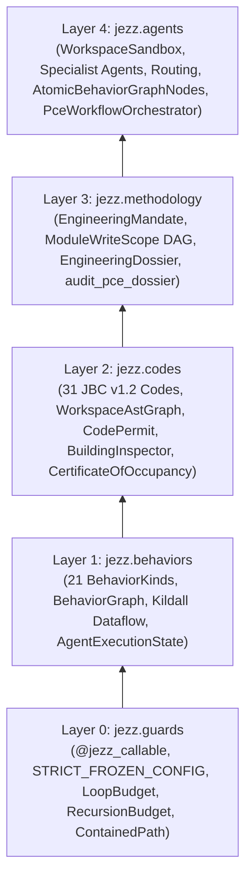
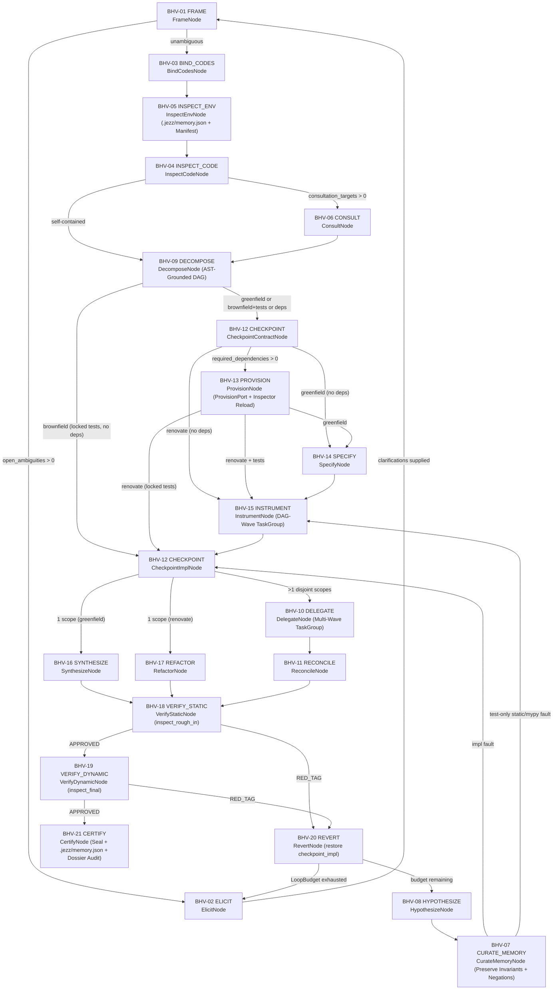

# Pillar 4 — Full Pydantic AI & Pydantic-Graph Runtime Implementation

## 1. Architectural Purpose: Zero-Entropy Enforcement Around Bounded Probabilistic Agents

Pillars 1, 2, and 3 established:
1. **Pillar 1 (`jezz.behaviors`):** A complete Fibonacci-cardinal ($F_8 = 21$) basis of atomic coding-agent behaviors (`BHV-01`..`BHV-21`), adjacency matrix, and Kildall fixed-point dataflow laws.
2. **Pillar 2 (`jezz.codes`):** The 31-provision **Jezz Software Building Code (`JBC` Edition 1.2)** enforced by `BuildingInspector` across `CodePermit`, Rough-In, Final Gate, and SHA-256 `CertificateOfOccupancy`.
3. **Pillar 3 (`jezz.methodology`):** **Permit-and-Contract Engineering (`PCE`)**—a 5-phase anti-SDD, anti-Agile engineering process audited by `audit_pce_dossier` ($\mathcal{I} \models_{\text{PCE}} \mathcal{M}$).

**Pillar 4 (`jezz.agents`)** compiles all three pillars into an executable runtime built atop `pydantic-ai`, `pydantic-graph`, and strict `pydantic` schemas (`STRICT_FROZEN_CONFIG`). Rather than pasting a prose "constitution" into an LLM prompt and hoping it behaves, `jezz.agents` wraps bounded probabilistic `pydantic_ai.Agent` specialists inside a deterministic `pydantic_graph.Graph` state machine where **capability boundaries, rollback checkpoints, static/dynamic inspections, and occupancy seals are enforced outside the LLM's authority**.

---

## 2. Strictly Acyclic 5-Layer Package Topology (`JBC-COG-003`)

Within `src/jezz/agents/`, internal imports also obey a strict DAG:
`agy_model.py` / `caching.py` $\to$ `providers.py` / `polyglot_prompts.py` / `schemas.py` $\to$ `env_introspect.py` $\to$ `memory.py` $\to$ `workspace.py` $\to$ `polyglot_gates.py` / `provision.py` $\to$ `specialists.py` $\to$ `routing.py` $\to$ `nodes.py` $\to$ `orchestrator.py` $\to$ `__init__.py`.

---

## 3. The 21-Behavior Execution Board (`BEHAVIOR_EXECUTION_BOARD`)

Every `BehaviorKind` in the $F_8 = 21$ basis is mapped bijectively inside `BEHAVIOR_EXECUTION_BOARD` (`types.MappingProxyType`, satisfying `JBC-COG-004`) and verified at runtime by `validate_execution_board_invariants()`:

1. **Zero-Entropy Deterministic Engines (`ExecutionEngineKind.DETERMINISTIC_ENGINE`, `ToolsetAccessLevel.NONE` — 7 behaviors):**
   - `BHV-03 BIND_CODES`, `BHV-11 RECONCILE`, `BHV-12 CHECKPOINT`, `BHV-18 VERIFY_STATIC`, `BHV-19 VERIFY_DYNAMIC`, `BHV-20 REVERT`, `BHV-21 CERTIFY`.
   - **Invariant:** No LLM can issue its own permit, reconcile write collisions via prose, skip a snapshot, waive a `RED_TAG`, or forge a `CertificateOfOccupancy`.
2. **Read-Only / Governance Pydantic AI Specialists (`ExecutionEngineKind.PYDANTIC_AI_AGENT`, `NONE` / `READ_ONLY` — 9 behaviors):**
   - `BHV-01 FRAME`, `BHV-02 ELICIT`, `BHV-04 INSPECT_CODE`, `BHV-05 INSPECT_ENV`, `BHV-06 CONSULT`, `BHV-07 CURATE_MEMORY`, `BHV-08 HYPOTHESIZE`, `BHV-09 DECOMPOSE`, `BHV-10 DELEGATE`.
   - Equipped exclusively with `build_readonly_toolset()` (`_tool_list_authorized_files`, `_tool_read_workspace_file`, `_tool_inspect_file_symbols`). Read-only epistemic behavior is enforced by capability absence, not prompt instruction.
3. **Scoped-Write Pydantic AI Specialists (`ExecutionEngineKind.PYDANTIC_AI_AGENT`, `ToolsetAccessLevel.SCOPED_WRITE` — 5 behaviors):**
   - `BHV-13 PROVISION`, `BHV-14 SPECIFY`, `BHV-15 INSTRUMENT`, `BHV-16 SYNTHESIZE`, `BHV-17 REFACTOR`.
   - **Exact Capability Bijection:** `SCOPED_WRITE` is granted *if and only if* `BEHAVIOR_BASIS[k].workspace_effect == WorkspaceEffect.MUTATE`.

---

## 4. Dual-Tier Self-Correction: `@output_validator` (`ModelRetry`) + Graph `RED_TAG` Rollback

`jezz.agents` enforces contracts at two complementary levels:

### Tier 1 — Intra-Step `pydantic-ai` Breakers (`workspace.py`, `env_introspect.py`, `specialists.py`, `nodes.py`)
- **Syntax & Closed-Schema Gate:** `FilePatchArtifact` parses every `.py` payload via `ast.parse` inside a Pydantic `@model_validator`, turning syntax errors into immediate structured-output retries.
- **PEP 695 `TypeAliasType` Misuse Gate (`find_type_alias_misuse`):** Deterministically scans candidate `src/` and `tests/` ASTs against `jezz.guards` and workspace `type X = ...` definitions, blocking runtime-fatal calls (`IdentifierStr("x")`) and non-generic subscripts (`BoundedInt[0, 10_000]`) in `<1ms` before Phase III locks `checkpoint_impl`.
- **Staged Runtime Import & Schema Rebuild Gate (`verify_runtime_importable_patches`):** Stages `src/` trees + candidate patches into an isolated contained directory, imports candidate modules via `importlib.import_module`, and invokes `cls.model_rebuild(force=True)` on every `BaseModel` subclass (catching `TypeError`, `PydanticUserError`, `AssertionError`/`icontract.ViolationError`, and import-time metaclass crashes during `_tool_preview_rough_in`, `_validate_specify_output`, and `_validate_synthesize_output`).
- **Workspace AST Graph & Non-Punitive Environment Introspection (`ast_graph.py`, `env_introspect.py`):**
  - `build_workspace_ast_graph` constructs a topological import/call map (`WorkspaceAstGraph`) whose `SymbolGraphEntry.signature_summary` embeds parameter annotations, `BaseModel` field schemas, and `StrEnum` literals; `_format_mandate_prompt` injects read-only upstream `src/` signatures into downstream multi-mandate runs so specialists never guess existing module contracts.
  - `inspect_installed_package_api` (`_tool_inspect_package_api`, with `importlib.invalidate_caches()`, `pkg.mod.Symbol` parent-module fallback, and side-effectful root blocklist) and `_tool_preview_rough_in` return structured `# NOT_FOUND` / `RED_TAG` strings rather than raising `ModelRetry`, preventing exploratory tool calls from exhausting `FunctionToolset` retry ceilings (`max_retries=4`).
- **Scope, Remediation, & Inline Snapshot Context:**
  - `_tool_preview_rough_in` and `_parse_and_rough_in_check` attach exact line numbers and statutory `-> Fix: {f.remediation}` instructions to every `RED_TAG` violation.
  - `_JBC_CANONICAL_EXEMPLAR` provides concise domain-agnostic `jezz.guards`, `LoopBudget`, `MappingProxyType`, and `Annotated[int, Field(...)]` idioms, while `_render_inline_authorized_snapshots` (`nodes.py`) embeds existing authorized Phase III files (`<= 24_000` chars) directly into downstream prompts to eliminate redundant read-tool roundtrips.
  - `build_specify_agent`, `build_instrument_agent`, and `build_synthesize_agent` enforce `ModuleWriteScope` file boundaries and verify all mandated `contract_symbols` and `verification_symbol`s exist in the combined AST.
- **Phase-Scoped Resource Breakers & Crash-Safe Rollback (`run_bounded_agent`, `orchestrator.py`):** Every `agent.run(...)` call is wrapped in `async with asyncio.timeout(budget.agent_timeout_sec):` (`JBC-FLT-005`) and `pydantic_ai.UsageLimits` (`PceRuntimeBudget.request_limit_for(kind)`, defaulting to `28` on `FRAME`/`SPECIFY` and `36` on `INSTRUMENT`/`SYNTHESIZE`/`REFACTOR`/`DELEGATE`), while `_rollback_aborted_sandbox` restores the earliest workspace checkpoint if an uncaught timeout or transport exception aborts mid-run.

### Tier 2 — Inter-Step `pydantic-graph` State Machine (`nodes.py`, `orchestrator.py` — `21 / 21` Behaviors)

### Key Runtime Guarantees
1. **Ambiguity Dominance & Resumable Authority Loop (`FRAME -> ELICIT -> FRAME`):** Any `EngineeringMandate` with non-empty `open_ambiguities` transitions immediately to `ElicitNode` without touching disk, while `--plan-only` (`PceRunStatus.HALTED_FOR_PLAN_APPROVAL`) halts cleanly after `DecomposeNode` so humans can inspect `--write-mandate` before Phase III mutation. When authoritative clarifications are supplied (via opt-in `--interactive` TTY callback bounded by `LoopBudget`, or out-of-process via `ElicitationTicket` and `jezz run --resume-elicitation ... --clarification ...`), execution re-enters `FrameNode` (`reframe_resolved`) in strict compliance with Pillar 1's `ELICIT -> FRAME` transition law.
2. **Brownfield Renovation & Differential Occupancy Ratchet (`PceWorkflowMode.RENOVATE` / `BHV-17 REFACTOR` / `jezz renovate [--ratchet]`):** Renovates existing `RED_TAG` Python, TypeScript, Rust, or Go repositories to `JBC` v1.2 occupancy while preserving observable public behavior—recording baseline `BuildingInspector` citations during `InspectCodeNode`, optionally locking/upgrading test suites (`tests/...`, `*.test.ts`, `*_test.go`) via `InstrumentNode`, and executing `RefactorNode` (`build_refactor_agent`) or parallel `DelegateNode` workers against locked tests. Passing `--ratchet` (`PceRuntimeBudget.ratchet_to_scope=True`, `EngineeringDossier.ratchet_scoped=True`) activates `inspect_differential_final` across `InspectCodeNode`, `VerifyStaticNode`, `VerifyDynamicNode`, and `CertifyNode`, enforcing full `JBC` v1.2 + whole-repo `JBC-COG-003` cycle/encapsulation compliance on authorized/modified files while isolating untouched legacy debt in large brownfield monorepos.
3. **AST-Grounded Topological DAG Planning & Multi-Wave Parallel Execution (`DECOMPOSE`, `INSTRUMENT`, `DELEGATE -> RECONCILE`):** Post-inspection `DecomposeNode` (`build_decompose_agent`) refines multi-scope mandates against `WorkspaceAstGraph` and validates acyclic `ModuleWriteScope.depends_on` waves via `compute_scope_execution_waves`. `InstrumentNode` fans out concurrent `asyncio.TaskGroup` workers across independent test-owning scopes, and `DelegateNode` executes topological waves sequentially (parallelizing independent scopes within each wave while exposing completed upstream module snapshots to downstream waves). `ReconcileNode` proves pairwise file-set disjointness before committing to the workspace.
4. **Anti-Blind-Retry Remediation (`RED_TAG -> REVERT -> HYPOTHESIZE -> CURATE_MEMORY -> CHECKPOINT`):** If Rough-In or Final inspection issues a `RED_TAG` (with `GateAttestation.summary` capturing exact `mypy` / `pytest` stderr diagnostics in `JBC-VRF-005`/`006`), `RevertNode` forwards pre-revert candidate snapshots to `HypothesizeNode`, restores `checkpoint_impl`, records citations in `WorldModelState.falsified_paths`, ticks a deterministic `LoopBudget`, and forces causal diagnosis (`BHV-08`) followed by `CurateMemoryNode` (`BHV-07`) compaction preserving active invariants and negations. Implementation faults route back to `CheckpointImplNode`, whereas test-only static/`mypy` faults (strictly excluding `pytest` failures so tests can never be weakened to pass broken code) route via `CheckpointContractNode -> InstrumentNode`. If `LoopBudget` is exhausted, `RevertNode` restores the clean baseline (`checkpoint_contract` when test edits faulted) and escalates via `ElicitNode` (`PceRunStatus.ESCALATED_AFTER_RED_TAG`).
5. **Trace & Dossier Soundness:** Every terminating execution path—whether `HALTED_FOR_ELICITATION`, `HALTED_FOR_PLAN_APPROVAL`, `ESCALATED_AFTER_RED_TAG`, 1-pass `OCCUPANCY_CERTIFIED`, `ELICIT -> FRAME` resumed `OCCUPANCY_CERTIFIED`, brownfield `RENOVATE` `OCCUPANCY_CERTIFIED`, or multi-cycle self-healed `OCCUPANCY_CERTIFIED`—induces a mathematically valid Pillar 1 `BehaviorGraph` (`verify_behavior_graph(result.induced_graph).is_valid == True`), and every certified run passes `audit_pce_dossier` across all five `PCE` phases.
6. **Multi-Model Specialist Routing & Per-Provider Vault Isolation (`routing.py`, `secrets.py`):** `[tool.jezz.models]` (plus `[tool.jezz.models.roles]`) and CLI tier flags (`--architect-model` for `FRAME`/`DECOMPOSE`/`SPECIFY`/`HYPOTHESIZE`, `--builder-model` for `PROVISION`/`INSTRUMENT`/`SYNTHESIZE`/`REFACTOR`, `--inspector-model` for `INSPECT_CODE`/`INSPECT_ENV`/`CONSULT`/`CURATE_MEMORY`, and `--model`) resolve all 12 `SpecialistRoleSlot` / `PceModelSuite` slots deterministically. Distinct model instances and Proton Pass `SecretStr` credentials are deduplicated per provider family, cross-provider `--api-key-uri` leakage is blocked (`JBC-SEC-002`), and every `AgentInvocationTelemetry` record stamps the exact `model_id` invoked.
7. **Full $F_8 = 21$ Runtime Node Closure, Polyglot Provisioning, & Real-Compiler Gate Conjunction (`memory.py`, `provision.py`, `polyglot_gates.py`, `polyglot_prompts.py`, `nodes.py`):** `PCE_BEHAVIOR_NODE_MAP` and `validate_runtime_node_coverage()` bind all `21 / 21` `BehaviorKind`s to `22` reachable `AtomicBehaviorGraphNode` subclasses across Python, TypeScript, Rust, and Go. `InspectEnvNode` (`BHV-05`) hydrates `<repo>/.jezz/memory.json` (`WorkspaceMemoryLedger`) and checks ecosystem manifests (`pyproject.toml`, `package.json`, `Cargo.toml`, `go.mod`); `ConsultNode` (`BHV-06`) resolves `JBC` clauses (`_tool_consult_building_code`), confined reference docs, and installed package APIs; `ProvisionNode` (`BHV-13`) executes validated `EngineeringMandate.required_dependencies` after `CheckpointContractNode` via `ProvisionPort` (`InProcessProvisionRunner` / `UvSubprocessProvisionRunner` / `PolyglotSubprocessProvisionRunner` running `uv add`, `npm install`, `cargo add`, and `go get`), reloads `BuildingInspector` (`JBC-VRF-003`), and rolls back manifests + lockfiles on `RED_TAG` exhaustion; `VerifyDynamicNode` (`BHV-19`) dispatches `PolyglotSubprocessGateRunner` (`mypy`+`pytest`, `tsc`+`vitest`/`node --test`, `cargo check`+`cargo test`, `go vet`+`go test` with fail-closed zero-test guards) evaluated under universal `all(...)` conjunction in `check_vrf_005`/`006`; and `CurateMemoryNode` (`BHV-07`) compacts remediation observations without dropping active invariants or `falsified_paths` negations before `CertifyNode` seals `.jezz/memory.json`.
8. **Read-Only Polyglot Statutory MCP Gate Server (`mcp_server.py`, `jezz mcp`):** Decouples Pillars 1–3 verification from the autonomous `PceWorkflowOrchestrator` so external host agents can invoke `jezz` over `stdio` MCP across **Python (`.py`), TypeScript (`.ts`/`.tsx`), Rust (`.rs`), and Go (`.go`)** with zero shell, mutation, network, or secret access. `JezzWorkspaceGate` jails all filesystem paths inside `anchor_root` (`--root`) via `ContainedPath` (`JBC-SEC-005`) and exposes 8 structured tools: `jbc_list_codes`, `jbc_get_code`, `jbc_verify_behavior_graph`, `jbc_inspect_workspace`, `jbc_inspect_differential`, `jbc_preview_source` (in-memory candidate `.py`/`.ts`/`.tsx`/`.rs`/`.go` buffer overlay preserving whole-workspace `JBC-COG-003` cycle and encapsulation checks before disk write), `jbc_query_ast_graph` (deterministic polyglot AST/CST import/topological-layer map, cross-module `caller_of` lookup, and `symbol_query` line-slice extraction), and `jbc_audit_dossier`.
9. **Portable Antigravity Plugin & Polyglot `Stop` Lifecycle Gate (`plugin.py`, `hooks.py`, `jezz init`, `jezz hook stop`):** `jezz init` generates a zero-hardcoded-path `.agents/plugins/jezz/` bundle (`plugin.json`, `mcp_config.json`, `hooks.json`, `rules/AGENTS.md`, `skills/pce/SKILL.md`) and optional `.git/hooks/pre-commit` ratchet, resolving `REPO_ROOT` dynamically at runtime from `${PLUGIN_ROOT}` and `dirname -- "$0"` (`JBC-SEC-006`). At agent turn boundaries, `jezz hook stop` evaluates `inspect_differential_rough_in` against `HEAD` across modified `.py`, `.ts`, `.tsx`, `.rs`, and `.go` units, returning `{"decision": "continue", "reason": "..."}` on unwaived `JBC` v1.2 `RED_TAG` or `SYNTAX_ERROR` findings (bounded by `--max-continuations`) and `{"decision": "allow"}` once clean occupancy is restored.
10. **Cross-Provider Prompt Caching, Zero-Credential `antigravity:<model>` Adapter, & Authenticated Provider Factory (`agy_model.py`, `caching.py`, `providers.py`, `specialists.py`, `nodes.py`):** `PromptCacheMode` (`auto` default, `off`, `prefix-only`, `5m`, `30m`, `1h`, `12h`) configures `pydantic_ai.ModelSettings(cache=...)` across `[tool.jezz.models].prompt_cache` and `--prompt-cache`, while `AntigravityCliModel` (`antigravity:<slug>`, e.g. `antigravity:claude-opus-5-5-medium`, `antigravity:claude-sonnet-5-5-medium`, `antigravity:gpt-oss-120b-medium`) bridges `pydantic-ai` structured output and multi-turn `--conversation <id>` prefix caches over the local `agy` CLI with zero external API keys. All `4` `JBC` construction specialists (`SPECIFY`, `INSTRUMENT`, `SYNTHESIZE`, `REFACTOR`) emit identical leading static `InstructionPart`s `(JBC_STATUTORY_BRIEF, JBC_CANONICAL_EXEMPLAR, specialist_role)` (`dynamic=False`), while `InstrumentNode`, `SynthesizeNode`, `RefactorNode`, and parallel `DelegateNode` slices insert `CachePoint` markers between shared `Mandate + Snapshots` prefixes and worker/remediation suffixes (automatically coalesced into a single `PartDict` on implicit-prefix models via `normalize_prompt_for_model`). `AgentInvocationTelemetry` and `PceWorkflowResult` track `cache_read_tokens`, `cache_write_tokens`, `cache_hit_ratio`, and `effective_billed_input_tokens`, and `verify_cross_provider_agent_compatibility` (`jezz.evals.cross_provider`) verifies all `16` (`12` `PCE` + `4` `SDD`) agents across `10` Google, Anthropic, OpenAI (Chat & Responses), OpenRouter, and Antigravity wire adapters (`640 / 640` probes).
