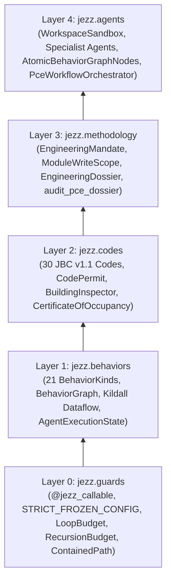
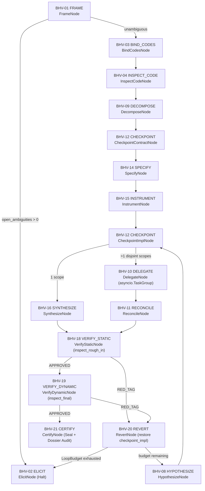

# Pillar 4 — Full Pydantic AI & Pydantic-Graph Runtime Implementation

## 1. Architectural Purpose: Zero-Entropy Enforcement Around Bounded Probabilistic Agents

Pillars 1, 2, and 3 established:
1. **Pillar 1 (`jezz.behaviors`):** A complete Fibonacci-cardinal ($F_8 = 21$) basis of atomic coding-agent behaviors (`BHV-01`..`BHV-21`), adjacency matrix, and Kildall fixed-point dataflow laws.
2. **Pillar 2 (`jezz.codes`):** The 30-provision **Jezz Software Building Code (`JBC` Edition 1.1)** enforced by `BuildingInspector` across `CodePermit`, Rough-In, Final Gate, and SHA-256 `CertificateOfOccupancy`.
3. **Pillar 3 (`jezz.methodology`):** **Permit-and-Contract Engineering (`PCE`)**—a 5-phase anti-SDD, anti-Agile engineering process audited by `audit_pce_dossier` ($\mathcal{I} \models_{\text{PCE}} \mathcal{M}$).

**Pillar 4 (`jezz.agents`)** compiles all three pillars into an executable runtime built atop `pydantic-ai`, `pydantic-graph`, and strict `pydantic` schemas (`STRICT_FROZEN_CONFIG`). Rather than pasting a prose "constitution" into an LLM prompt and hoping it behaves, `jezz.agents` wraps bounded probabilistic `pydantic_ai.Agent` specialists inside a deterministic `pydantic_graph.Graph` state machine where **capability boundaries, rollback checkpoints, static/dynamic inspections, and occupancy seals are enforced outside the LLM's authority**.

---

## 2. Strictly Acyclic 5-Layer Package Topology (`JBC-COG-003`)

Within `src/jezz/agents/`, internal imports also obey a strict DAG:
`schemas.py` $\to$ `workspace.py` $\to$ `specialists.py` $\to$ `nodes.py` $\to$ `orchestrator.py` $\to$ `__init__.py`.

---

## 3. The 21-Behavior Execution Board (`BEHAVIOR_EXECUTION_BOARD`)

Every `BehaviorKind` in the $F_8 = 21$ basis is mapped bijectively inside `BEHAVIOR_EXECUTION_BOARD` (`types.MappingProxyType`, satisfying `JBC-COG-004`) and verified at runtime by `validate_execution_board_invariants()`:

1. **Zero-Entropy Deterministic Engines (`ExecutionEngineKind.DETERMINISTIC_ENGINE`, `ToolsetAccessLevel.NONE` — 7 behaviors):**
   - `BHV-03 BIND_CODES`, `BHV-11 RECONCILE`, `BHV-12 CHECKPOINT`, `BHV-18 VERIFY_STATIC`, `BHV-19 VERIFY_DYNAMIC`, `BHV-20 REVERT`, `BHV-21 CERTIFY`.
   - **Invariant:** No LLM can issue its own permit, reconcile write collisions via prose, skip a snapshot, waive a `RED_TAG`, or forge a `CertificateOfOccupancy`.
2. **Read-Only / Governance Pydantic AI Specialists (`ExecutionEngineKind.PYDANTIC_AI_AGENT`, `NONE` / `READ_ONLY` — 9 behaviors):**
   - `BHV-01 FRAME`, `BHV-02 ELICIT`, `BHV-04 INSPECT_CODE`, `BHV-05 INSPECT_ENV`, `BHV-06 CONSULT`, `BHV-07 CURATE_MEMORY`, `BHV-08 HYPOTHESIZE`, `BHV-09 DECOMPOSE`, `BHV-10 DELEGATE`.
   - Equipped exclusively with `build_readonly_toolset()` (`_tool_list_authorized_files`, `_tool_read_workspace_file`, `_tool_inspect_file_symbols`). Read-only epistemic behavior is enforced by capability absence, not prompt instruction.
3. **Scoped-Write Pydantic AI Specialists (`ExecutionEngineKind.PYDANTIC_AI_AGENT`, `ToolsetAccessLevel.SCOPED_WRITE` — 5 behaviors):**
   - `BHV-13 PROVISION`, `BHV-14 SPECIFY`, `BHV-15 INSTRUMENT`, `BHV-16 SYNTHESIZE`, `BHV-17 REFACTOR`.
   - **Exact Capability Bijection:** `SCOPED_WRITE` is granted *if and only if* `BEHAVIOR_BASIS[k].workspace_effect == WorkspaceEffect.MUTATE`.

---

## 4. Dual-Tier Self-Correction: `@output_validator` (`ModelRetry`) + Graph `RED_TAG` Rollback

`jezz.agents` enforces contracts at two complementary levels:

### Tier 1 — Intra-Step `pydantic-ai` Breakers (`specialists.py`)
- **Syntax & Closed-Schema Gate:** `FilePatchArtifact` parses every `.py` payload via `ast.parse` inside a Pydantic `@model_validator`, turning syntax errors into immediate structured-output retries.
- **Scope & Symbol `@output_validator`s:**
  - `build_specify_agent` runs `BuildingInspector.inspect_rough_in` directly on Phase III contract patches and verifies all `declared_symbols` compile—raising `pydantic_ai.ModelRetry` with exact `JBC` citations if any contract violates `JBC` v1.1.
  - `build_instrument_agent` runs `BuildingInspector.inspect_rough_in` on Phase III test files—blocking `assert True` theatre (`JBC-VRF-001`) or `# noqa` suppression (`JBC-VRF-004`) via `ModelRetry` before Construction starts.
  - `build_synthesize_agent` enforces `ModuleWriteScope` file boundaries and verifies all mandated `contract_symbols` and `verification_symbol`s exist in the combined AST.
- **Resource Breakers (`run_bounded_agent`):** Every `agent.run(...)` call is wrapped in `async with asyncio.timeout(budget.agent_timeout_sec):` (`JBC-FLT-005`) and `pydantic_ai.UsageLimits` (`request_limit`, `tool_calls_limit`, `total_tokens_limit`).

### Tier 2 — Inter-Step `pydantic-graph` State Machine (`nodes.py`, `orchestrator.py`)

### Key Runtime Guarantees
1. **Ambiguity Dominance (`FRAME -> ELICIT`):** Any `EngineeringMandate` with non-empty `open_ambiguities` halts immediately at `ElicitNode` (`PceRunStatus.HALTED_FOR_ELICITATION`) without touching disk.
2. **Disjoint Parallel Subagent Construction (`DELEGATE -> RECONCILE`):** Multi-scope mandates fan out one `synthesize_agent` per `ModuleWriteScope` inside `async with asyncio.TaskGroup() as tg:`, each confined to `sandbox.scoped_view(scope)`. `ReconcileNode` proves pairwise file-set disjointness before writing to the parent workspace.
3. **Anti-Blind-Retry Remediation (`RED_TAG -> REVERT -> HYPOTHESIZE -> CHECKPOINT`):** If Rough-In or Final inspection issues a `RED_TAG`, `RevertNode` restores `checkpoint_impl` (wiping defective implementation edits while preserving Phase III contracts and tests), records the `RED_TAG` citations in `WorldModelState.falsified_paths`, ticks a deterministic `LoopBudget`, and forces causal diagnosis through `HypothesizeNode` (`BHV-08`) before re-attempting construction. If the `LoopBudget` is exhausted, `RevertNode` leaves the workspace clean and escalates via `ElicitNode` (`PceRunStatus.ESCALATED_AFTER_RED_TAG`).
4. **Trace & Dossier Soundness:** Every terminating execution path—whether `HALTED_FOR_ELICITATION`, `ESCALATED_AFTER_RED_TAG`, 1-pass `OCCUPANCY_CERTIFIED`, or multi-cycle self-healed `OCCUPANCY_CERTIFIED`—induces a mathematically valid Pillar 1 `BehaviorGraph` (`verify_behavior_graph(result.induced_graph).is_valid == True`), and every certified run passes `audit_pce_dossier` across all five `PCE` phases.
