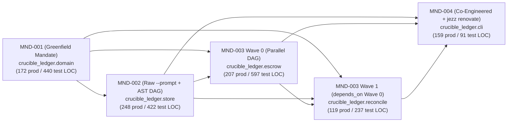

# Track 5 — Multi-Mandate Longitudinal Crucible (`jezz-crucible-ledger`) & `JBC` Edition `1.2`

## 1. Experimental Objective: Beyond Single-Mandate Scratch Workspaces

Tracks 3 and 4 evaluated `PceWorkflowOrchestrator` on isolated, single-mandate greenfield builds (`1` mandate per fresh workspace). Real-world software engineering is **longitudinal**: new subsystems must import and honor previously sealed domain contracts without mutating out-of-scope modules, multi-module features form directed acyclic dependency waves (`ModuleWriteScope.depends_on`), and legacy or co-engineered entrypoints must be renovated (`BHV-17 REFACTOR`) under locked behavioral tests and live IDE/CLI lifecycle hooks.

Track 5 stress-tests `jezz` across an end-to-end, 4-mandate financial software repository—**`jezz-crucible-ledger`** (*Double-Entry Integer-Cent Ledger & Escrow Engine*, `11` Python units, `2,693` LOC)—using role-tiered routing (`google:gemini-4-hydrogen` Architect + `google:gemini-3.8-flash` Builder/Inspector via Proton Pass `pass-cli` `SecretStr` vault resolution) alongside the **Antigravity plugin & `Stop` hook harness** (`jezz init`, `jezz hook stop`).

### 1.1 Longitudinal Subsystem Dependency Graph

---

## 2. Sequential Mandate Ledger & Occupancy Seals

Across all four sequential mandates, every certified build achieved **`0` unwaived `JBC` violations**, **`0` `CodeVariance` waivers**, **`0` `RED_TAG -> REVERT` construction rollbacks** on the sealed run, **`100%` `mypy --strict` and `pytest` + `Hypothesis` pass (`21/21` suite functions)**, and deterministic `OCCUPANCY_SEALED` verification via `jezz audit <dossier.json> --repo .`:

| Mandate / Git Commit | Execution Mode & Topology | Scopes / Waves / Invariants | Induced CFG Nodes / Reverts | Cumulative Repo Units / LOC (`Prod` + `Test`) | `CertificateOfOccupancy` SHA-256 Seal |
| :--- | :--- | :---: | :---: | :---: | :--- |
| **`MND-CRUCIBLE-LEDGER-DOMAIN`** (`b6856c5`) | Greenfield `--mandate` (`domain.py` + `test_domain.py`): `AccountKind`, `EntrySide`, `AccountBalance`, `PostingLeg`, `JournalEntry`, exact conservation `apply_journal_entry` | `1` scope / `1` wave / `4` invariants | `12` nodes / **`0` reverts** | `3` units / `613` LOC (`173` + `440`) | `sha256:f238ebf4de4415bf...` |
| **`MND-CRUCIBLE-LEDGER-STORE`** (`3be1612`) | Greenfield `--prompt` (`FRAME -> INSPECT_CODE -> DECOMPOSE`): `SqliteLedgerStore` with `?` placeholders, `SAVEPOINT sp_ledger` rollback, idempotency conflict detection, bounded `fetchmany` | `1` scope / `1` wave / `5` invariants | `12` nodes / **`0` reverts** | `5` units / `1,283` LOC (`421` + `862`) | `sha256:5a3460eb2e64e0b7...` |
| **`MND-ESCROW-RECONCILE-001`** (`2e673d3`) | Multi-scope `--mandate` with `reconcile_scope.depends_on = ("escrow_scope",)`: parallel `InstrumentNode` (`TaskGroup`) + 2-wave `DelegateNode -> ReconcileNode` (`escrow.py` + SHA-256 `reconcile.py`) | `2` scopes / `2` waves / `7` invariants | `13` nodes / **`0` reverts** | `9` units / `2,443` LOC (`747` + `1,696`) | `sha256:3e5a346b0458e9a6...` |
| **`MND-CRUCIBLE-LEDGER-CLI-RENOVATE`** (`76a5bc8`) | Interactive Mode 1 (`tests/test_cli.py`) + Brownfield `jezz renovate` (`BHV-17 REFACTOR`) renovating a `10`-violation legacy `cli.py` (`json.loads`, `Any`, `elif` chain, unchained `except`, missing `@jezz_callable`) to `0` violations | `1` scope / `1` wave / `3` invariants | `9` nodes / **`0` reverts** | `11` units / **`2,693` LOC** (`906` + `1,787`) | `sha256:dc3676adcacf077d...` |

### 2.1 Live Antigravity `Stop` Lifecycle Gate Verification (`MND-004`)
Before executing `jezz renovate` in Mandate 4, the unrenovated `src/crucible_ledger/cli.py` (`10` `JBC` violations across `JBC-DBC-002`, `JBC-DBC-004`, `JBC-DBC-005`, `JBC-FLT-002`, `JBC-SEC-003`, `JBC-SEC-004`, `JBC-COG-004`) was evaluated through `jezz hook stop` over `stdio`:
- **Pre-Renovation Turn Boundary:** `jezz hook stop` intercepted termination and emitted `{"decision": "continue", "reason": "JBC ... Statutory Stop Gate (RED_TAG — 10 unwaived violation(s) in modified workspace files): ..."}` with exact file/line locations and `-> Fix:` remediations, while leaving untouched upstream modules unpenalized.
- **Post-Renovation Turn Boundary:** After `PceWorkflowOrchestrator` (`PceWorkflowMode.RENOVATE`) refactored `cli.py` in a single pass (`MappingProxyType` settlement dispatch, `ScenarioInput.model_validate_json`, `@jezz_callable`, chained `LedgerCliError`) and passed locked `tests/test_cli.py`, `jezz hook stop` returned `{"decision": "allow"}`.

---

## 3. Seven Longitudinal Runtime & Analyzer Calibrations

Executing four sequential, interdependent mandates surfaced seven structural edge cases invisible to single-mandate benchmarks—each resolved via domain-agnostic framework hardening (`508c77f`):

1. **Explicit `--interactive` Opt-In for Background PTY Harnesses (`cli_interactive.py`, `specialists.py`):**
   - *Failure Mode:* Automated process runners allocate a pseudo-terminal (`sys.stdin.isatty() == True`) with no human operator attached, causing default `stdin.readline()` elicitation callbacks to block indefinitely when `FrameNode` surfaced minor convention questions.
   - *Calibration:* Required explicit `--interactive` before attaching `make_terminal_elicitation_callback`, defaulting non-interactive CLI runs to clean `ElicitationTicket` serialization (`exit 3`), and grounded `build_frame_agent` on fixed `jezz.guards` conventions so unambiguous `JBC` idioms never trigger false ambiguities.
2. **Crash-Safe Sandbox Rollback & `480s` Per-Step Ceiling (`orchestrator.py`, `workspace.py`, `cli.py`):**
   - *Failure Mode:* When an uncaught step timeout or transport error aborted mid-run after `SpecifyNode` had written `src/` contracts, partial Phase III files remained on disk.
   - *Calibration:* Added `WorkspaceSandbox.has_checkpoint` and `_rollback_aborted_sandbox` (`try / except BaseException:`) in `PceWorkflowOrchestrator._run_workflow` to restore the earliest clean checkpoint on any unhandled exception; raised the CLI per-step cap from `240s` to `min(480.0, timeout_sec)`; and guided `build_frame_agent` toward `3..5` cohesive `DomainInvariant`s per module.
3. **Non-Punitive Package & Rough-In Tool Responses (`env_introspect.py`, `workspace.py`):**
   - *Failure Mode:* Raising `ModelRetry` inside `_tool_inspect_package_api` (on `pkg.mod.Symbol` dotted paths or freshly written modules prior to `importlib.invalidate_caches()`) and `_tool_preview_rough_in` incremented `FunctionToolset`'s retry counter across turns, aborting valid runs at `max_retries=2`.
   - *Calibration:* Added `importlib.invalidate_caches()` and parent-module attribute fallback (`pkg.mod` $\to$ `Symbol`) to `inspect_installed_package_api`, converted tool misses and rough-in findings into structured `# NOT_FOUND` / `RED_TAG (...)` return strings rather than `ModelRetry` exceptions, and raised `FunctionToolset(max_retries=4)`.
4. **Multi-Layout First-Party Workspace Root Discovery (`inspector.py`, `JBC-VRF-003`):**
   - *Failure Mode:* Repositories whose PEP 621 distribution name (`name = "jezz-crucible-ledger"`) differs from their import package (`src/crucible_ledger`) failed `JBC-VRF-003` (*Epistemic Import Grounding*) when importing `from crucible_ledger.domain import ...`.
   - *Calibration:* Extended `BuildingInspector.from_workspace` to discover first-party roots from `[tool.hatch.build.targets.wheel].packages`, `[tool.setuptools].packages`, `src/*/__init__.py` directories, and `SourceUnit.module_name` roots.
5. **`GateAttestation.summary` Propagation & Test-Only `mypy` Remediation Loop (`rules_vrf.py`, `nodes.py`, `specialists.py`):**
   - *Failure Mode:* `check_vrf_005`/`006` discarded subprocess `mypy`/`pytest` stderr (`GateAttestation.summary`), `RevertNode` wiped candidate `src/` before `HypothesizeNode` could read it, and a `mypy --strict` `[comparison-overlap]` error inside `tests/test_domain.py` (`StrEnum == "literal"`) could not be repaired by `SynthesizeNode` because `tests/` is write-locked during Phase IV.
   - *Calibration:* Surfaced `GateAttestation.summary` inside `JBC-VRF-005`/`006` violation messages, passed pre-revert candidate snapshots to `HypothesizeNode`, routed **test-only** static/`mypy` `RED_TAG`s (strictly excluding `pytest` failures so tests can never be weakened to pass broken code) via `HYPOTHESIZE -> CHECKPOINT -> INSTRUMENT`, restored `checkpoint_contract` on `ESCALATED_AFTER_RED_TAG` when test edits faulted, and documented `StrEnum.MEMBER.value == 'literal'` in `build_instrument_agent`.
6. **Cross-Mandate Read-Only Upstream AST Signature Grounding (`ast_graph.py`, `nodes.py`):**
   - *Failure Mode:* In Mandate 3, `escrow.py` and `reconcile.py` needed exact parameter types, `BaseModel` fields, and `StrEnum` member values from read-only upstream `domain.py` and `store.py` (`MND-001` & `MND-002`) located outside Mandate 3's `ModuleWriteScope`s.
   - *Calibration:* Enriched `SymbolGraphEntry.signature_summary` in `WorkspaceAstGraph` with parameter type annotations, `BaseModel` field schemas, and `StrEnum` literals, and injected read-only upstream `src/` signatures directly into `_format_mandate_prompt`.
7. **DAG-Wave-Aware Parallel `InstrumentNode` (`nodes.py`):**
   - *Failure Mode:* Authoring multiple full `Hypothesis` test suites (`tests/test_escrow.py` + `tests/test_reconcile.py`, `834` combined lines) inside a single sequential `InstrumentNode` call exceeded single-agent latency bounds.
   - *Calibration:* Added `_partition_invariants_by_test_scope` and `_run_parallel_instrument_scopes` inside `InstrumentNode`, fanning out concurrent per-scope `build_instrument_agent` workers via `asyncio.TaskGroup` confined to `sandbox.scoped_view(scope)`.

---

## 4. Statutory Edition `1.2`: `JBC-SEC-006` & Portable Dynamic Path Anchoring

Auditing the Step 1 Antigravity plugin generator (`src/jezz/plugin.py`) and interactive CLI flags (`src/jezz/cli_interactive.py`) exposed a subtle agentic portability defect (`AGT-PATH-01`, `CWE-426`, `ISO/IEC 25010 §4.2.8`): `jezz init` was serializing host-resolved absolute workspace paths into `.agents/plugins/jezz/mcp_config.json`, `hooks.json`, and `.git/hooks/pre-commit`, making committed workspace plugins break on any other machine, container, or clone path.

To eliminate this class of defect permanently across both `jezz` and agent-authored repositories (`cbccb3d`):
1. **Codified `JBC-SEC-006` (*Dynamic Path Anchoring & Hardcoded Path Prohibition*, `STRUCTURAL`, Edition `1.2` — `31` total / `29` static provisions):**
   - `check_sec_006` (`src/jezz/codes/rules_sec_obs.py`) bans hardcoded host/OS filesystem literals (user home roots, OS temp/system prefixes, tilde-home strings, and drive-letter roots) across all `src/` and `tests/` units, and bans direct string-literal `Path(...)` / `os.path.*(...)` constructor calls in production modules.
2. **Zero-Hardcoded-Path Plugin & Hook Generation (`src/jezz/plugin.py`):**
   - Workspace `mcp_config.json` and `hooks.json` resolve `REPO_ROOT` dynamically at execution time from Antigravity's injected `${PLUGIN_ROOT}` environment variable (`REPO_ROOT="$(CDPATH= cd -- "${PLUGIN_ROOT:-.}/../../.." && pwd)"`), while `.git/hooks/pre-commit` resolves `REPO_ROOT` relative to `dirname -- "$0"`.
3. **Grandfathered Permit Soundness:**
   - Because `audit_pce_dossier` verifies `dossier.permit.bound_code_ids <= set(dossier.inspection_report.effective_code_ids)`, advancing `CODEBOOK_EDITION` to `"1.2"` (`31` provisions) preserves 100% deterministic audit validity of all four historical Edition `1.1` dossiers in `jezz-crucible-ledger`, while `uv run jezz inspect .` certifies both `jezz` (`65` units) and `jezz-crucible-ledger` (`11` units) at **`APPROVED` (`0` violations across all `29` static Edition `1.2` provisions)**.

---

## 5. `Wave 4E` — Falsifying Availability-Halt Hypotheses & Closing `6 / 6` Tiered Benchmark Tasks

In Track 4 (`Wave 4D`), `case_03_artifact_loader` was the sole `1 / 6` task that halted fail-closed on symmetric tiered routing (`google:gemini-4-hydrogen` Architect + `google:gemini-3.8-flash` Builder/Inspector). Previously (§6.2 of the Edition `1.1` white paper), two plausible explanations were proposed: (H1) the `28`-request per-stage budget was slightly too tight, or (H2) `INSTRUMENT` on security-heavy I/O harnesses required routing to the frontier `ARCHITECT` tier.

Track 5 tested both hypotheses directly via controlled `pydantic-evals` A/B runs under `JBC` Edition `1.2` (`31` provisions including `JBC-SEC-006`):

| Probe | Intervention Tested on `case_03_artifact_loader` | Control: Prose "SDD" (`JBC` / `mypy` / Self-Tests / Oracle / Spec Lines) | Treatment: `jezz` `PCE` v1.2 (`JBC` / `mypy` / Self-Tests / Oracle / Outcome) |
| :--- | :--- | :---: | :---: |
| **`Wave 4E-1`** | **H1 (Budget-Only):** Raise `INSTRUMENT`/`SYNTHESIZE` cap `28` $\to$ `36` on `gemini-3.8-flash` | `17` viol. (`RED_TAG`, incl. `JBC-SEC-006`, `JBC-VRF-004`, `CC=23`) / `Pass` / `Pass` / `3/3` / `356` lines (`[x]`) | **H1 Falsified:** Halted at `UsageLimitExceeded: 36` (`528.6s`); `_rollback_aborted_sandbox` restored clean baseline (`0` defects shipped) |
| **`Wave 4E-2`** | **H2 (Role-Tiering):** Route `instrument = "google:gemini-4-hydrogen"` via `[tool.jezz.models.roles]` | `8` viol. (`RED_TAG`, incl. `JBC-VRF-004`, `CC=18`) / `Pass` / `Pass` / `3/3` / `457` lines (`[x]`) | **H2 Falsified:** Halted at `UsageLimitExceeded: 36` (`413.2s`); clean sandbox rollback (`0` defects shipped) |
| **`Wave 4E-3`** | **Root-Cause Calibration (`env_introspect.py` + `specialists.py`):** Expose own-class methods (`ContainedPath.from_parts`), multi-hop `pkg.mod.Class.method` fallback, and `TypeAliasType` signatures on **original symmetric tiered routing** | `12` viol. (`RED_TAG`, **`2` `LIFE_SAFETY`**, incl. `JBC-SEC-006`, `JBC-VRF-004`, `CC=19`) / **`Fail`** / **`Fail`** / `3/3` / `367` lines (`[x]`) | **`OCCUPANCY_CERTIFIED` (`0 / 31` `JBC` v1.2 violations, `Pass` / `Pass` / `3/3` (`100%`) Oracle, `CC = 0`, `3` statements in `loader.py`, `1` self-healed rollback)** |

### 5.1 Forensic Root Cause (`Calibration #8` — Class-Method & `TypeAliasType` API Introspection)
Capturing live `pydantic-ai` run messages (`capture_run_messages`) revealed why both `gemini-3.8-flash` and `gemini-4-hydrogen` exhausted request limits on `case_03_artifact_loader`:
- `inspect_installed_package_api` (`src/jezz/agents/env_introspect.py`) previously inspected only module top-level `vars(mod)` callables and classes—omitting **public methods on exported classes** (`ContainedPath.from_parts`, `LoopBudget.tick`), omitting **PEP 695 `TypeAliasType` definitions** (`IdentifierStr`, `ShortText`), and peeling only one `.` segment on `ModuleNotFoundError` (failing on `jezz.guards.ContainedPath.from_parts`). Specialists spent dozens of tool turns querying `symbol_filter='from_parts'` and receiving empty `Callables: []` responses.
- Upgrading `inspect_installed_package_api` to surface own-class method signatures (`def ContainedPath.from_parts(...)`), multi-hop attribute chains, and `type Name = ...` aliases—paired with a 4-line `ContainedPath.from_parts` + `read_bounded_text` idiom in `_JBC_CANONICAL_EXEMPLAR`—resolved the bottleneck without promoting `INSTRUMENT` or `SYNTHESIZE` off `gemini-3.8-flash`.
- In `Wave 4E-3`, `SynthesizeNode` emitted a **25-line `src/artifact_loader/loader.py`** (`3` executable statements, **`0` Cognitive Complexity**, `0/31` `JBC` v1.2 violations) versus Control SDD's `506` lines (`CC = 19`, `12` `JBC` violations including `JBC-SEC-006` hardcoded `/tmp` and `/etc/passwd` literals, failed `mypy --strict`, and failed self-tests behind checked-off `- [x]` `tasks.md`), completing **`6 / 6` (`100.0%`) task closure on symmetric tiered routing** across `Wave 4D + Wave 4E`.

