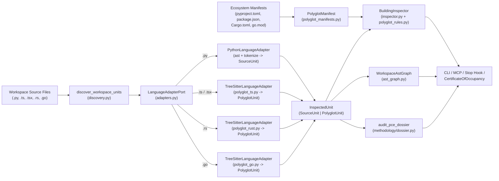

# Track 8 — Polyglot `JBC` Edition `1.2` Inspector & Six-Repository Brownfield Field Trial

## 1. Executive Summary

Tracks 1–7 proved that **Permit-and-Contract Engineering (`PCE`)** and the **Jezz Software Building Code (`JBC` Edition `1.2` — 31 provisions across 6 Articles)** eliminate silent safety escapes and verify behavioral completeness across Python codebases. Track 8 removes the single-language boundary on Pillar 2 and Pillar 3 static verification, generalizing `jezz` into a **four-language polyglot inspection, AST/CST graph, MCP, lifecycle-hook, and `PCE` dossier-auditing stack** spanning:

1. **Python (`.py`)** — stdlib `ast` + `tokenize` (`SourceUnit`, `pyproject.toml` + `setup.cfg`).
2. **TypeScript (`.ts`, `.tsx`)** — `tree-sitter-typescript` (`PolyglotUnit`, `package.json` + monorepo `packages/*` / `apps/*` workspaces + `@types/*` companions).
3. **Rust (`.rs`)** — `tree-sitter-rust` (`PolyglotUnit`, `Cargo.toml` + `[workspace.members]` + `[workspace.dependencies]` crate renames).
4. **Go (`.go`)** — `tree-sitter-go` (`PolyglotUnit`, `go.mod` `module` / `require` / `replace` directives).

All enforcement surfaces operate natively across mixed-language and single-language repositories without external compiler daemons:
- **Core Engine & Manifests (`jezz.codes`):** `LanguageAdapterPort`, `InspectedUnit = Annotated[SourceUnit | PolyglotUnit, InstanceGuard((SourceUnit, PolyglotUnit))]`, `BuildingInspector.from_workspace`, `discover_workspace_units(..., languages=...)`, `inspect_differential_rough_in`, `build_workspace_ast_graph`, and `extract_symbol_source_slice`.
- **CLI & Lifecycle Gates (`jezz.cli`, `jezz.hooks`):** `jezz inspect [--language python|typescript|rust|go]`, `--changed-since` / `--staged` Differential Occupancy Ratchets, `jezz audit`, and `jezz hook stop` (blocking agent turn completion when modified `.py`, `.ts`, `.tsx`, `.rs`, or `.go` files introduce unwaived `RED_TAG` or `SYNTAX_ERROR` findings).
- **Statutory `stdio` MCP Server (`jezz.mcp_server`):** In-memory pre-write `jbc_preview_source` (overlaying unsaved `.py`/`.ts`/`.tsx`/`.rs`/`.go` buffers onto the whole-workspace graph to catch both per-unit hazards and cross-module `JBC-COG-003` cycles/encapsulation leaks before disk write), `jbc_inspect_workspace`, `jbc_inspect_differential`, `jbc_query_ast_graph`, and `jbc_audit_dossier`.
- **`PCE` Dossier & Seal Grounding (`jezz.methodology`):** Polyglot symbol verification (`::` and `.` qualified identifiers across `ModuleWriteScope.contract_symbols` and `DomainInvariant.verification_symbol`), authorized ecosystem lockfiles/manifests (`package.json`, `Cargo.toml`, `go.mod`), and permutation-invariant SHA-256 `CertificateOfOccupancy` digests (`compute_units_digest`).

Empirical stress-testing across **6 production open-source repositories** (`colinhacks/zod`, `honojs/hono`, `BurntSushi/ripgrep`, `serde-rs/json`, `go-chi/chi`, and `spf13/cobra` — **`1,110` units / `300,067` LOC / `15,936` AST/CST graph symbols**) completed with **`0` crashes and `0` CST parse errors** in **`62.95s`** (`4,077–5,588 LOC/s`, `9.8–40.4 MB` peak traced memory), surfacing **`6,926` calibrated `JBC` Edition `1.2` violations** and driving 4 permanent analyzer calibrations (`Calibrations 8A–8D`).

---

## 2. Hexagonal Polyglot Architecture (`src/jezz/codes/`)

### Core Polyglot Modules

| Module | Responsibility & Key Invariants |
| :--- | :--- |
| `src/jezz/codes/polyglot_ir.py` | Defines `SupportedLanguage` (`python`, `typescript`, `rust`, `go`), `SUPPORTED_SOURCE_EXTENSIONS`, `EcosystemManifest`, `PolyglotManifest`, `PolyglotParam`, `PolyglotCallable`, `PolyglotTypeDecl`, `PolyglotImport`, `PolyglotUnit`, `GuardedPolyglotUnit`, `type InspectedUnit = Annotated[SourceUnit \| PolyglotUnit, InstanceGuard((SourceUnit, PolyglotUnit))]` ($O(1)$ `@jezz_callable` boundary validation without recursive dataclass copying), and fail-closed `parse_cst_root` (raising `SyntaxError` on `ERROR` or `MISSING` CST nodes). |
| `src/jezz/codes/polyglot_manifests.py` | Parses `package.json` (including `packages/*` and `apps/*` monorepo workspaces and `@types/*` dev-companion expansion), `Cargo.toml` (including `[workspace.members]`, `[workspace.dependencies]`, target-specific tables, and `package = "..."` crate renames), and `go.mod` (`module`, `require`, `replace`, and `GO_STDLIB_ROOTS`). |
| `src/jezz/codes/polyglot_cst.py` | Bounded iterative CST walkers (`iter_cst_nodes`, `iter_local_cst_nodes` governed by `LoopBudget`), language-parameterized SonarSource Cognitive Complexity (`compute_cst_callable_metrics`), `else if` / post-jump `else` checks (`check_cst_cog_004_conditionals`), string literal SQL/secret/crypto/path scanners (`scan_cst_string_hazards`), and comment scanners (`scan_deferred_comments`, `scan_suppression_comments`). |
| `src/jezz/codes/polyglot_rules.py` | Universal `PolyglotUnit` rule evaluators (`DBC-001..005`, `FLT-004`, `SEC-002..004`, `COG-001`, `COG-002`, Hitz–Montazeri `LCOM4`/`WMC`/stateless-method/schema-purity `COG-005`, `OBS-002`, `VRF-001`, `VRF-003`) plus whole-graph iterative Tarjan SCC cycle detection (`check_polyglot_cog_003` / `check_polyglot_cog_003_for_paths`). |
| `src/jezz/codes/polyglot_ts.py` | TypeScript (`.ts`/`.tsx`) CST extractor, TS 4.7–5.0 grammar normalization bridge, Zod `.strict()`/`z.strictObject` schema inspector, Vitest/Jest test-block extractor, and Node/Web API hazard scanners. |
| `src/jezz/codes/polyglot_rust.py` | Rust (`.rs`) CST extractor, `#[cfg(test)]` / `#[test]` / `#[should_panic]` / `#[ignore]` attribute scoping, `#[derive(Deserialize)]` + `#[serde(deny_unknown_fields)]` wire inspector, and `unsafe`/`unwrap`/RAII/tokio hazard scanners. |
| `src/jezz/codes/polyglot_go.py` | Go (`.go`) CST extractor, `*_test.go` & `/internal/` package encapsulation checker, JSON struct-tag + `Validate()`/`DisallowUnknownFields()` wire inspector, and blank-identifier/goroutine/`http.DefaultClient` hazard scanners. |
| `src/jezz/codes/adapters.py` | `LanguageAdapterPort` protocol, `LANGUAGE_ADAPTERS` `MappingProxyType` dispatch table (`JBC-COG-004`), `adapter_for_path` (skipping ambient `.d.ts` unless `include_ambient_dts=True`), `parse_any_source_unit`, and `detect_unit_triggers`. |

---

## 3. Four-Language `JBC` Edition `1.2` Lowering Matrix (Articles I–VI)

Every static Rough-In provision (`29` rules) and Final Gate attestation (`2` rules) in `JBC` Edition `1.2` evaluates across all four languages:

| Code | Python (`.py`) | TypeScript (`.ts` / `.tsx`) | Rust (`.rs`) | Go (`.go`) |
| :--- | :--- | :--- | :--- | :--- |
| **`JBC-DBC-001`** | `@icontract.require`/`ensure`, `@field_validator`, zero-divisor guards | `assert`/`invariant`/guard clauses; unguarded divisor params; vacuous `assert(true)` | `assert!`/`debug_assert!`/`ensure!`/`.checked_div()`; vacuous `assert!(true)` | Guard clauses / `.Validate()`; unguarded `/` or `%` divisor parameters |
| **`JBC-DBC-002`** | Missing annotations; `Any` / `cast()` | Missing param/return annotations; `: any` or `as any` type erasure | `dyn Any` / `std::any::Any` / raw `*const c_void` / `*mut c_void` | `any` or `interface{}` in parameters, returns, or struct fields |
| **`JBC-DBC-003`** | Mixed bare/value `return` or implicit `None` fallthrough | Mixed `return;` / `return expr;` or missing terminal return on non-`void` | `.unwrap()` / `.expect()` in production (non-`#[cfg(test)]`) code | Naked `return` with named return parameters |
| **`JBC-DBC-004`** | `@jezz_callable` runtime signature breaker on public callables | Exported callables require runtime type/schema guard (`.parse`, `typeof`, `throw`) | `pub fn` with unbounded inputs requires guard (`if`/`match`/`assert!`/`Err`) | Exported `Func` with unbounded inputs requires guard (`if`/`switch`/`.Validate()`) |
| **`JBC-DBC-005`** | Unbounded `str`/`int`/`float`/`list`/`dict` on public signatures/models | Unbounded `string`/`number`/`T[]` on unguarded exports or `z.string()` without `.max`/`.min` | Unbounded `String`/`&str`/`Vec<T>`/`HashMap` on unguarded `pub fn` or `#[derive(Deserialize)]` | Unbounded `string`/`[]T`/`map[K]V`/`float64` on unguarded exports or unvalidated `json:` structs |
| **`JBC-FLT-001`** | Bare `except:` or silent `except ...: pass` | Empty `catch {}` or `.catch(() => {})` | `let _ = fallible_call()` or `.ok()` discarding `Result` in production | Blank identifier `_ = call()` discarding returned `error`/value in production |
| **`JBC-FLT-002`** | `raise NewErr()` inside `except` without `from exc`; bare `Exception` | `throw "str"` (primitive), `new Error("")`, or `catch` rethrow without `{ cause }` | Empty `panic!()` or `.map_err(\|_\| ...)` discarding source error | Library `panic(...)`, `errors.New("")`, or `fmt.Errorf` in `err != nil` without `%w` |
| **`JBC-FLT-003`** | Open handle without `with`; `subprocess`/`httpx` without `timeout=` | `fetch()` without `AbortSignal`/`signal`; `execSync`/`spawnSync` without `timeout` | `reqwest::get` / `TcpStream::connect` without timeout; `std::mem::forget` leaking `Drop` | `http.Get`/`Post`/`Head` (`DefaultClient`); `os.Open`/`sql.Open` without `defer Close()` |
| **`JBC-FLT-004`** | `while` without `LoopBudget.tick()`; recursion without fuel | `while` / `for (;;)` without `.tick()`; recursion without `maxDepth`/`fuel` | `loop` / `while` without `.tick()`; recursion without `max_depth`/`fuel` | Condition/infinite `for` without `.Tick()`; recursion without `maxDepth`/`fuel` |
| **`JBC-FLT-005`** | Bare `asyncio.create_task` / `Thread.start`; missing `asyncio.timeout` | Fire-and-forget `void asyncCall()` detaching `Promise` lifecycle | Detached `tokio::spawn` / `std::thread::spawn` dropping `JoinHandle` | Unsupervised `go fn()` without `sync.WaitGroup` or `errgroup` |
| **`JBC-FLT-006`** | `@functools.cache`; uncapped `.read()` / `.read_text()` / `.fetchall()` | Unbounded `fs.readFileSync` / `fs.promises.readFile` full-file slurp | Unbounded `fs::read_to_string` / `fs::read` / `.read_to_end()` without `.take()` | Unbounded `io.ReadAll` / `os.ReadFile` without `io.LimitReader` |
| **`JBC-SEC-001`** | `eval`/`exec`/`pickle`/`yaml.load`, `shell=True`, SQL f-strings | `eval()`, `new Function()`, `child_process.exec()`, interpolated SQL `.query()` | `unsafe {}`, `mem::transmute`, `Command::new("sh").arg("-c")`, `format!` SQL | `unsafe.Pointer`, `exec.Command("sh", "-c", ...)`, `+`/`Sprintf` SQL `.Query`/`.Exec` |
| **`JBC-SEC-002`** | Hardcoded secrets/tokens; unredacted `password`/`api_key` model fields; secret logging | Hardcoded secret literals (`sk-`, `ghp_`, PEM); unredacted `apiKey`/`secret` fields | Hardcoded secret literals; `#[derive(Debug)]` struct with unredacted secret field; `tracing` leak | Hardcoded secret literals; exported `json:` secret struct field; `slog` secret leak |
| **`JBC-SEC-003`** | `BaseModel` missing `extra='forbid'`, `strict=True`, `allow_inf_nan=False` | `z.object({...})` missing `.strict()` or `z.strictObject(...)` | `#[derive(Deserialize)]` struct missing `#[serde(deny_unknown_fields)]` | `json.NewDecoder` without `dec.DisallowUnknownFields()` |
| **`JBC-SEC-004`** | Untyped `dict[str, Any]` boundary payloads; `json.loads` without `TypeAdapter` | `Record<string, any\|unknown>` boundary bags; unvalidated `JSON.parse()` | `serde_json::Value` / `HashMap<String, Value>` on public boundary signatures | `map[string]any` boundary bags; `json.Unmarshal` into `map[string]any` / `any` |
| **`JBC-SEC-005`** | Raw `str`/`Path` passed to file/subprocess/network sinks without `ContainedPath` | Raw string/identifier passed to `fs.*` or `fetch()` without containment/URL validation | Raw string/identifier passed to `fs::*` / `File::open` without canonical containment | Raw string/identifier passed to `os.Open`/`ReadFile`/`WriteFile`/`RemoveAll` |
| **`JBC-SEC-006`** | Hardcoded `/etc`, `/Users`, `/tmp`, `~/` literals; literal `Path("...")` in prod | Hardcoded host/OS path literals; literal `path.resolve("/...")` in production | Hardcoded host/OS path literals; literal `Path::new("...")` / `PathBuf::from("...")` in prod | Hardcoded host/OS path literals; literal `filepath.Join("/...", ...)` in production |
| **`JBC-COG-001`** | SonarSource Cognitive Complexity $\le 15$ per callable | SonarSource Cognitive Complexity $\le 15$ per function/method/arrow | SonarSource Cognitive Complexity $\le 15$ per `fn` / `impl` method | SonarSource Cognitive Complexity $\le 15$ per `func` / receiver method |
| **`JBC-COG-002`** | Nesting $\le 4$, arity $\le 6$, statements $\le 35$ | Nesting $\le 4$, arity $\le 6$, statements $\le 35$ | Nesting $\le 4$, arity $\le 6$, statements $\le 35$ | Nesting $\le 4$, arity $\le 6$, statements $\le 35$ |
| **`JBC-COG-003`** | Tarjan SCC cycles, `import *`, cross-module `_private` imports | Tarjan SCC cycles, runtime `import * as` / `export *`, `_private` imports | Tarjan SCC cycles, `use ...::*`, cross-module `_private` `use` items | Tarjan SCC cycles, dot `import . "..."`, cross-tree `/internal/` package breach |
| **`JBC-COG-004`** | $>1$ `elif`, post-jump `else`, mutable module dispatch dicts | $>1$ `else if` branch or redundant `else` after `return`/`throw`/`break`/`continue` | $>1$ `else if` branch or redundant `else` after `return`/`break`/`continue` | $>1$ `else if` branch or redundant `else` after `return`/`break`/`continue` |
| **`JBC-COG-005`** | `LCOM4 <= 1`, `0` stateless methods, $\le 5$ fields, $\le 7$ pub methods, `WMC <= 35`, pure schemas | Same `LCOM4` / stateless / field / method / `WMC <= 35` / I/O purity laws on TS classes | Same `LCOM4` / stateless `&self` / field / `pub fn` / `WMC <= 35` laws on `struct` + `impl` | Same `LCOM4` / stateless receiver / field / exported method / `WMC <= 35` laws on `struct` |
| **`JBC-OBS-001`** | `print()`, `breakpoint()`, `pdb.set_trace()` in production | `console.log`/`debug`/`info` or `debugger;` in production modules | `println!`, `eprintln!`, or `dbg!` in production (non-test) Rust modules | `fmt.Print`/`Println`/`Printf` or builtin `println`/`print` in production Go |
| **`JBC-OBS-002`** | Mutable default args (`=[]`), `global` statement, mutable module globals | Mutable default params (`= []`, `= {}`, `= new Map()`), module-level `let` / `var` | `static mut` unsynchronized global state | Package-level mutable `var` declarations and stateful `func init()` |
| **`JBC-OBS-003`** | Weak `md5`/`sha1`, unseeded `random.*`, `os.environ` mutation | `Math.random()`, `createHash("md5"\|"sha1")`, production `process.env` mutation | `md5`/`sha1`, global `rand::random()`/`thread_rng()`, `env::set_var`/`remove_var` | `crypto/md5` or `sha1`, global `math/rand`, `os.Setenv`/`Unsetenv` in production |
| **`JBC-VRF-001`** | Zero-assertion `test_*` or tautological `assert True` / `assert x == x` | Zero-assertion `it()`/`test()` or reflexive `expect(x).toBe(x)` | Zero-assertion `#[test]` or vacuous `assert!(true)` / reflexive `assert_eq!(x, x)` | Zero-assertion `TestXxx(t *testing.T)` or reflexive `if x == x` test check |
| **`JBC-VRF-002`** | Empty `pass`/`...`/`NotImplementedError` bodies; `# TODO`/`FIXME` | Empty exported function/method bodies, `throw Error("not implemented")`, `// TODO`/`FIXME` | `todo!()` / `unimplemented!()` macros in production; `// TODO`/`FIXME` comments | Empty exported `func` bodies, `panic("not implemented")`, `// TODO`/`FIXME` comments |
| **`JBC-VRF-003`** | Imports grounded in stdlib, workspace, or `pyproject.toml`/`setup.cfg` | Imports grounded in `node:`/`bun:` builtins, relative modules, or `package.json` | `use` crates grounded in `std`/`core`/`alloc`, workspace crates, or `Cargo.toml` | `import` paths grounded in `GO_STDLIB_ROOTS`, module prefix, or `go.mod` |
| **`JBC-VRF-004`** | `# noqa`, `# type: ignore`, `# pragma: no cover`, `@pytest.mark.skip` | `@ts-ignore`, `@ts-expect-error`, `@ts-nocheck`, `eslint-disable`, `biome-ignore`, `.skip` | `#[allow(...)]`, `#![allow(...)]`, `#[ignore]` without active `CodeVariance` | `//nolint`, `//lint:ignore`, `t.Skip()`/`t.Skipf()` without active `CodeVariance` |
| **`JBC-VRF-005`** / **`006`** | `GateAttestation` (`STATIC_TYPES` + `DYNAMIC_SUITE` with watchdog ceilings) | Same `GateAttestation` contract (`tsc` + `vitest` / test runner) | Same `GateAttestation` contract (`cargo check`/`clippy` + `cargo test`) | Same `GateAttestation` contract (`go vet` + `go test`) |

---

## 4. Four-Language `PCE` Crucible Verification (`tests/test_track8_polyglot_inspector.py`)

`tests/test_track8_polyglot_inspector.py` (`13` deterministic unit, async MCP, crucible, and `Hypothesis` property tests) verifies both adversarial hazard detection across all 6 `JBC` Articles and full 5-phase `PCE` certification on a seeded 4-language repository (`MND-POLYGLOT-CRUCIBLE-01`):

- **Four Disjoint `ModuleWriteScope`s & Cross-Language `DomainInvariant`s:**
  - `scope_python` (`src/py_ledger/quota.py`, `tests/test_quota.py`) $\to$ `INV-001` (`test_apply_bonus_cents_adds_amounts`).
  - `scope_typescript` (`src/ts_gateway/wire.ts`, `depends_on={"scope_python"}`) $\to$ `INV-002` (`ts_gateway.wire.parseWireTransfer`).
  - `scope_rust` (`crates/rs_core/src/escrow.rs`, `depends_on={"scope_python"}`) $\to$ `INV-003` (`escrow::allocate_escrow`).
  - `scope_go` (`internal/go_settle/receipt.go`, `depends_on={"scope_typescript", "scope_rust"}`) $\to$ `INV-004` (`internal.go_settle.BuildReceipt`).
- **Verified End-to-End Guarantees:**
  1. `jezz inspect <crucible>` certifies `APPROVED` across all 6 `.py`/`.ts`/`.rs`/`.go` units (`0` violations), and `--language rust` filters cleanly to the Rust crate slice.
  2. `build_workspace_ast_graph` resolves all 6 polyglot modules (`has_import_cycles=False`) and `extract_symbol_source_slice` returns exact line-numbered slices across TypeScript, Rust, and Go symbols.
  3. Over `stdio` MCP, `jbc_preview_source` flags an unsaved `src/ts_gateway/rogue.ts` buffer (`any` return + `console.log` + unvalidated `JSON.parse`) as `red_tag` and approves a clean `crates/rs_core/src/fee.rs` buffer without writing to disk.
  4. Dropping an untracked `.rs` file containing `.unwrap()` and `let _ = raw.parse()` causes `evaluate_stop_hook` (`jezz hook stop`) to return `StopHookDecisionKind.CONTINUE` citing `JBC-DBC-003` and `JBC-FLT-001`, and `jezz inspect --changed-since HEAD` exits `1`; removing the rogue file restores `StopHookDecisionKind.ALLOW`.
  5. `audit_pce_dossier`, `jezz audit`, and `JezzWorkspaceGate.audit_dossier` verify all `10 / 10` compiled symbols across the 4 languages and seal `OCCUPANCY_SEALED` against the permutation-invariant SHA-256 `CertificateOfOccupancy` digest.

---

## 5. Six-Repository Brownfield Polyglot Field Trial (`300,067` LOC)

To stress-test the polyglot `BuildingInspector` and `WorkspaceAstGraph` against real-world language idioms, monorepo layouts, macro systems, and modern type syntax at zero LLM cost, `jezz inspect` audited **6 high-adoption open-source TypeScript, Rust, and Go repositories** (`1,110` source units, `300,067` LOC, `15,936` AST/CST graph symbols).

### Table 1: Performance, Memory, AST/CST Graph, & Severity Summary

| Repository (`@ commit`) | Language | Units | Total LOC | Rough-In Time (`LOC/s`) | Peak Traced Mem | AST Graph (`ms` / Symbols / Cycles) | `LIFE_SAFETY` | `STRUCTURAL` | `WORKMANSHIP` | Total Violations |
| :--- | :---: | ---: | ---: | ---: | ---: | :---: | ---: | ---: | ---: | ---: |
| **`colinhacks/zod`** (`@ d40c329910`) | TypeScript (`.ts`) | `503` | `102,395` | `21,969.7 ms` (`4,660.7/s`) | `40,396.5 KB` | `14.01 ms` / `5,497` / `True` | `351` | `3,109` | `614` | **`4,074`** |
| **`honojs/hono`** (`@ 9075031ea4`) | TypeScript (`.ts`/`.tsx`) | `316` | `85,851` | `15,362.0 ms` (`5,588.5/s`) | `25,505.3 KB` | `10.32 ms` / `4,231` / `True` | `202` | `1,119` | `215` | **`1,536`** |
| **`BurntSushi/ripgrep`** (`@ 4a51093f78`) | Rust (`.rs`) | `104` | `58,463` | `14,116.1 ms` (`4,141.6/s`) | `30,205.2 KB` | `7.66 ms` / `3,463` / `False` | `53` | `312` | `183` | **`548`** |
| **`serde-rs/json`** (`@ f51fa15a70`) | Rust (`.rs`) | `61` | `23,380` | `4,352.4 ms` (`5,371.8/s`) | `20,524.3 KB` | `3.96 ms` / `1,638` / `True` | `34` | `205` | `31` | **`270`** |
| **`go-chi/chi`** (`@ c64ed7d663`) | Go (`.go`) | `90` | `13,213` | `3,036.3 ms` (`4,351.7/s`) | `9,839.7 KB` | `2.31 ms` / `490` / `False` | `24` | `201` | `41` | **`266`** |
| **`spf13/cobra`** (`@ adbc881390`) | Go (`.go`) | `36` | `16,765` | `4,111.7 ms` (`4,077.4/s`) | `12,117.5 KB` | `1.54 ms` / `617` / `False` | `41` | `149` | `42` | **`232`** |
| **Corpus Total** | **TS / TSX / Rust / Go** | **`1,110`** | **`300,067`** | **`62,948.2 ms` (`4,766.9/s`)** | **`40.4 MB` max** | **`39.80 ms` / `15,936`** | **`705`** | **`5,095`** | **`1,126`** | **`6,926`** |

### Table 2: Per-Article Violation Distribution Across the Six Repositories

| Repository | Art. I (`DBC`) | Art. II (`FLT`) | Art. III (`SEC`) | Art. IV (`COG`) | Art. V (`OBS`) | Art. VI (`VRF`) | Dominant `JBC` Provisions |
| :--- | ---: | ---: | ---: | ---: | ---: | ---: | :--- |
| **`colinhacks/zod`** | `2,045` | `134` | `135` | `642` | `467` | `651` | `DBC-002` (`1,796`), `COG-003` (`450`), `OBS-001` (`377`), `VRF-001` (`307`), `VRF-004` (`249`), `DBC-005` (`160`) |
| **`honojs/hono`** | `554` | `63` | `111` | `194` | `80` | `534` | `VRF-004` (`419`), `DBC-002` (`417`), `VRF-001` (`111`), `COG-004` (`86`), `DBC-004` (`74`), `SEC-002` (`73`) |
| **`BurntSushi/ripgrep`** | `167` | `98` | `35` | `202` | `12` | `34` | `COG-005` (`100`), `DBC-003` (`98`), `FLT-004` (`65`), `COG-002` (`36`), `DBC-005` (`35`), `COG-003` (`31`) |
| **`serde-rs/json`** | `44` | `56` | `63` | `70` | `4` | `33` | `FLT-004` (`45`), `SEC-004` (`44`), `COG-003` (`43`), `VRF-004` (`22`), `DBC-003` (`19`), `SEC-001` (`16`) |
| **`go-chi/chi`** | `98` | `69` | `8` | `34` | `48` | `9` | `DBC-005` (`51`), `OBS-002` (`41`), `DBC-004` (`30`), `FLT-002` (`29`), `FLT-001` (`18`), `DBC-002` (`16`) |
| **`spf13/cobra`** | `101` | `50` | `10` | `41` | `15` | `15` | `DBC-005` (`44`), `DBC-004` (`36`), `FLT-001` (`26`), `COG-002` (`23`), `DBC-002` (`19`), `OBS-002` (`14`) |

### Representative True-Positive Citations Verified in the Field Corpus

- **TypeScript (`zod` & `hono`):**
  - `hono/src/context.ts:609` (`JBC-COG-001` / `JBC-COG-002`): `Context.#newResponse` exhibits Cognitive Complexity `38` (limit `15`) and nesting depth `5` (limit `4`).
  - `hono/src/adapter/bun/serve-static.ts:25` & `zod/packages/bench/memory/leaks.ts:72` (`JBC-FLT-001`, `LIFE_SAFETY`): Empty `catch {}` blocks silently discarding runtime faults.
  - `zod/packages/docs/loaders/stars.ts:82` (`JBC-FLT-002`): Replacement `new Error(...)` thrown inside `catch` without `{ cause }`, severing causal stack provenance.
  - `zod/packages/zod/src/v3/ZodError.ts:281` & `hono/src/helper/ssg/ssg.ts:313` (`JBC-DBC-003`): Mixed bare/value `return` paths in `ZodError.assert` and `saveContentToFile`.
  - `zod/packages/bench/compile-scaling.ts:32` (`JBC-DBC-001`): Unguarded divisor parameter `iters` in `time()`.
  - `zod` (`450` `JBC-COG-003` findings): Circular `v4/core` $\leftrightarrow$ schema imports (matching `zod`'s own `package.json` script `--exclude '(v4/core|v3)'` acknowledging circularity) plus wildcard namespace re-exports.
- **Rust (`ripgrep` & `serde-rs/json`):**
  - `ripgrep/crates/cli/src/process.rs:230` (`JBC-FLT-006`): Unbounded `self.stderr.read_to_end()` without `.take(MAX_BYTES)` stream cap.
  - `ripgrep/crates/cli/src/decompress.rs:109` & `serde_json/src/number.rs:146` (`JBC-FLT-001`, `LIFE_SAFETY`): `let _ = call()` and `.ok()` silently discarding `Result` error payloads.
  - `serde_json/src/value/mod.rs:251` (`JBC-FLT-002`): `.map_err(|_| ...)` discarding the underlying source error cause.
  - `ripgrep/crates/core/flags/hiargs.rs:39` & `serde_json/src/de.rs:31` (`JBC-COG-005`): Monolithic `HiArgs` (`WMC = 121`) and `Deserializer` (`WMC = 276`) exceeding the `WMC <= 35` single-duty ceiling, while `ripgrep`'s crate graph passes `ast_graph_has_cycles == False` cleanly.
  - `serde_json` (`16` `JBC-SEC-001` findings): Low-level `unsafe` UTF-8/slice blocks requiring explicit safety-justified `CodeVariance` permits under `JBC` governance.
- **Go (`chi` & `cobra`):**
  - `chi/tree.go:822` & `cobra/command.go:1844` (`JBC-DBC-003`): Naked `return` statements on named-return functions `longestPrefix` and `Command.Flag`.
  - `cobra/bash_completions.go:692` & `chi/_examples/fileserver/main.go:39` (`JBC-FLT-001`, `LIFE_SAFETY`): Blank identifier `_` discarding returned `error` outcomes.
  - `cobra/cobra.go:150` & `chi/_examples/fileserver/main.go:50` (`JBC-FLT-002`): Library `panic()` calls crashing the host process instead of returning typed `error` values.
  - `cobra/bash_completions.go:652` (`JBC-FLT-004`): Unbounded recursive `gen` function without a `maxDepth`/`fuel` ceiling.
  - `cobra/bash_completions_test.go:67` (`JBC-FLT-005`): Unsupervised `go` goroutine spawn without `sync.WaitGroup` or `errgroup` coordination.
  - `cobra/command.go:54` (`JBC-COG-005`) & `chi/_examples/todos-resource/todos.go:9` (`JBC-COG-005`): `Command` God-struct (`WMC = 391`) and stateless receiver methods (`List`, `Create`, `Get`, `Update`, `Delete`, `Sync`) on `todosResource`.

---

## 6. Permanent Analyzer Calibrations Derived from the Field Trial (`8A–8D`)

1. **Calibration 8A — Compiler-Diagnostic Negative Fixture Pruning (`src/jezz/codes/discovery.py`):**
   Go's `cmd/go` toolchain reserves `testdata/` directories for intentionally malformed fixtures, and Rust's `trybuild` harness stores compile-fail UI fixtures under `tests/ui/` (e.g., `serde_json/tests/ui/parse_expr.rs`). Adding `testdata`, `ui`, `compile_fail`, `__snapshots__`, `target`, `vendor`, `coverage`, and `out` to `_PRUNED_DIR_NAMES` aligned workspace discovery with native toolchain semantics.
2. **Calibration 8B — Linear-Time $O(N)$ Line-Preserving TypeScript 4.7–5.0 Grammar Bridge (`src/jezz/codes/polyglot_ts.py`):**
   `tree-sitter-typescript==0.23.2` predates three valid TypeScript 4.7–5.0 constructs used heavily across `zod` v4 and `hono`: generic `in`/`out` variance modifiers (`interface $ZodType<out Output = unknown, in Input = unknown>`), `export type * from "./..."`, and semicolon-free consecutive generic call signatures inside interfaces. `_parse_ts_root_with_modern_bridge` normalizes all three constructs in $O(N)$ time with non-backtracking line-preserving replacements *only* when the raw parse reports a CST error, retaining fail-closed `SyntaxError` rejection on genuinely broken syntax and achieving **`0` CST parse errors across all `819` `.ts`/`.tsx` units**.
3. **Calibration 8C — Monorepo `packages/*` & `apps/*` Manifest Merging (`src/jezz/codes/polyglot_manifests.py`):**
   In npm/pnpm/nub monorepos such as `zod`, sub-packages (`packages/bench/package.json`, `packages/docs/package.json`) declare workspace-local dependencies (`valibot`, `effect`, `@sinclair/typebox`, `typia`) omitted from the root `package.json`. Extending `load_package_json_manifest` (`_discover_npm_workspace_manifests`) to merge member `dependencies`, `peerDependencies`, `optionalDependencies`, and `@types/*`-expanded `devDependencies` (symmetric with `load_cargo_toml_manifest`) eliminated `78` false-positive `JBC-VRF-003` findings in `zod`.
4. **Calibration 8D — Compile-Time Type Assertions & Delegated Test-Helper Recognition (`polyglot_ts.py`, `polyglot_rust.py`, `polyglot_go.py`):**
   Real-world polyglot test suites frequently express postconditions via Vitest's `expectTypeOf<T>().toEqualTypeOf<U>()` (`zod`, `hono`), Rust `#[should_panic]` attributes or helper macros/functions (`SearcherTester::test()`, `test_encode_ok(...)`, `eqnice!` in `ripgrep` and `serde_json`), and Go test helpers accepting `t *testing.T` (`assertNoErr(t, err)`, `checkStringContains(t, ...)` in `cobra` and `chi`). Recognizing these idioms—analogous to Python's `check_vrf_001` helper-prefix rule—eliminated **`554` false-positive `JBC-VRF-001` findings** (`632` total false positives combined with `8C`, reducing `ripgrep` `VRF-001` from `140 -> 5`, `serde_json` `54 -> 10`, `cobra` `70 -> 2`, `chi` `12 -> 0`, `hono` `285 -> 111`, and `zod` `428 -> 307`) while preserving `100%` detection on assertion-free smoke theatre and reflexive tautologies.
