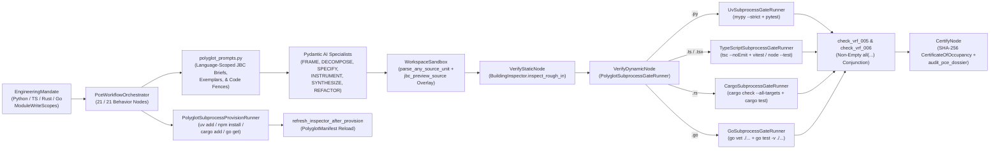

# Track 9 — Polyglot Autonomous `PCE` Runtime (`jezz run` & `jezz renovate` Across Python, TypeScript, Rust, and Go)

## 1. Executive Summary

Track 8 generalized Pillar 2 (`jezz.codes`) and Pillar 3 (`jezz.methodology`) static inspection, AST/CST graphs, CLI/MCP/Stop-hook ratchets, and `CertificateOfOccupancy` dossier seals across **Python (`.py`), TypeScript (`.ts`, `.tsx`), Rust (`.rs`), and Go (`.go`)**. Track 9 closes the remaining runtime boundary in **Pillar 4 (`jezz.agents`)**, turning `PceWorkflowOrchestrator` (`jezz run` and `jezz renovate`) into a **four-language autonomous Permit-and-Contract Engineering (`PCE`) engine**:

1. **Polyglot Workspace Sandbox & In-Memory Preview (`workspace.py`):** Generalized `WorkspaceSandbox.load_units()`, `_tool_inspect_file_symbols`, and `_tool_preview_rough_in` to `InspectedUnit` (`SourceUnit | PolyglotUnit`), running pre-write CST Rough-In checks and whole-workspace `JBC-COG-003` cycle/encapsulation overlays across `.py`, `.ts`, `.tsx`, `.rs`, and `.go` buffers before disk mutation.
2. **Real-Compiler Polyglot Dynamic Gate Runners (`polyglot_gates.py`, `rules_vrf.py`):** Added `TypeScriptSubprocessGateRunner` (`tsc --noEmit` + `vitest` / `npm test` / `node --test`), `CargoSubprocessGateRunner` (`cargo check --all-targets` + `cargo test`), `GoSubprocessGateRunner` (`go vet ./...` + `go test -v ./...`), and composite `PolyglotSubprocessGateRunner`, paired with **non-empty universal conjunction (`all(...)`)** in `check_vrf_005` / `check_vrf_006` and **fail-closed zero-test detection** so neither `cargo test` (`0 passed`) nor `go test` (`[no test files]`) nor a passing sibling language can mask an untested or failing ecosystem.
3. **Ecosystem-Aware `BHV-13 PROVISION` & Manifest Reload (`mandate.py`, `provision.py`):** Generalized `DependencyRequirement` (PEP 508, scoped npm `@scope/pkg` + `^`/`~` semver, Cargo crates, and domain-anchored Go module paths while blocking CLI flags, URLs, path traversal, and invalid unscoped `import_root` tokens), `compute_missing_dependencies`, `refresh_inspector_after_provision`, `InProcessProvisionRunner`, and `PolyglotSubprocessProvisionRunner` (`uv add`, `npm install`, `cargo add`, `go get`).
4. **Language-Routed Statutory Briefs & Cache-Preserving Specialist Prompts (`polyglot_prompts.py`, `specialists.py`, `nodes.py`):** Added canonical `JBC` Edition `1.2` briefs and exemplars for TypeScript, Rust, and Go alongside byte-identical Python prompt preservation (`languages=None` or `{PYTHON}`), polyglot code fences (`code_fence_for_path`), polyglot test-path classification (`is_polyglot_test_path` covering `*.test.ts`, `*.spec.tsx`, `*_test.go`, `tests/*.rs`), and per-slice language routing in multi-wave `DelegateNode` execution.

Live end-to-end validation across **4 real-compiler polyglot LLM trials (`Probes 9A–9D`)** on symmetric tiered routing (`--architect-model google:gemini-4-hydrogen --builder-model google:gemini-3.8-flash`) achieved **`4 / 4` (`100%`) Pass-1 `OCCUPANCY_CERTIFIED` (`0` rollbacks, `0` unwaived `JBC` v1.2 violations)** and **`4 / 4` `OCCUPANCY_SEALED` SHA-256 `EngineeringDossier`s**, uncovering a striking empirical result: **native-idiom token compression (`47.7K–82.5K` gross input tokens, `11–19` requests, `26.5%–57.3%` prompt-cache hit ratios)**—roughly **`4x–5x` fewer gross tokens** than Python `PCE` builds because `JBC` v1.2 lowers directly onto pretrained compiler and stdlib idioms in TypeScript, Rust, and Go.

---

## 2. Polyglot Runtime Architecture (`src/jezz/agents/`)

### Core Track 9 Modules & Upgrades

| Module | Responsibility & Enforced Runtime Laws |
| :--- | :--- |
| `src/jezz/agents/polyglot_prompts.py` | Defines `JBC_TYPESCRIPT_{BRIEF,EXEMPLAR}`, `JBC_RUST_{BRIEF,EXEMPLAR}`, and `JBC_GO_{BRIEF,EXEMPLAR}`; classifies test artifacts across all 4 ecosystems (`is_polyglot_test_path`); maps file suffixes to Markdown fences (`code_fence_for_path`); detects active workspace/mandate languages (`detect_workspace_languages`); and guarantees byte-identical `InstructionPart` stability when `is_pure_python_languages(languages)` holds. |
| `src/jezz/agents/polyglot_gates.py` | Implements `TypeScriptSubprocessGateRunner`, `CargoSubprocessGateRunner`, `GoSubprocessGateRunner`, and composite `PolyglotSubprocessGateRunner` (`_SubprocessGateSpec` with `LoopBudget`-governed active-language dispatch and hard `timeout_sec` watchdogs). Explicitly fails closed when `cargo test` (`0` `is_test_callable` units) or `go test` (`0` `*_test.go` units) would otherwise exit `0` vacuously. |
| `src/jezz/codes/rules_vrf.py` | Strengthens `check_vrf_005` (`STATIC_TYPES`) and `check_vrf_006` (`DYNAMIC_SUITE`) from existential `any(...)` to non-empty universal `all(...)` over matching `GateAttestation`s, preventing any passing language runner in a mixed-language build from masking a failing or timed-out ecosystem runner. |
| `src/jezz/methodology/mandate.py` | Extends `DependencyRequirement` (`ecosystem_spec`, `_is_valid_import_root`) across PEP 508, scoped npm (`@scope/pkg`, `^`/`~` semver), Cargo crates, and domain-anchored Go modules while preserving fail-closed rejection of CLI flags (`--pre`), URLs (`git+`, `https://`, `file:`), `..` traversal, shell metacharacters, and invalid unscoped `import_root` strings. |
| `src/jezz/agents/provision.py` | Generalizes `compute_missing_dependencies`, `refresh_inspector_after_provision`, and `InProcessProvisionRunner` across `pyproject.toml`, `package.json`, `Cargo.toml`, and `go.mod`, and adds `PolyglotSubprocessProvisionRunner` (`uv add`, `npm install --save-exact`, `cargo add`, `go get`) with full manifest + lockfile checkpoint rollback on `RED_TAG` exhaustion. |
| `src/jezz/agents/workspace.py`, `specialists.py`, `nodes.py`, `cli.py` | Widens `WorkspaceSandbox`, `DynamicGatePort`, output validators, inline snapshot rendering, and `DelegateNode` worker slices to `InspectedUnit`, and wires `PolyglotSubprocessGateRunner` + `PolyglotSubprocessProvisionRunner` into `jezz run` and `jezz renovate`. |

---

## 3. Deterministic & Real-Compiler Suite (`tests/test_track9_polyglot_runtime.py`)

`tests/test_track9_polyglot_runtime.py` (`8` unit, `Hypothesis` property, real-compiler subprocess, and parallel multi-language `PCE` orchestration tests; repository suite **`183 passed`**) verifies:

1. **Conjunction Soundness (`check_vrf_005` / `check_vrf_006`):** `Hypothesis` property tests over arbitrary non-empty `GateAttestation` vectors prove `JBC-VRF-005` and `JBC-VRF-006` pass if and only if *every* active language gate passes within its timeout ceiling.
2. **Polyglot `DependencyRequirement` Injection & `import_root` Guards:** Accepts scoped npm (`@zod/core@^4.0.0`), Cargo (`serde@1.0`), and Go (`github.com/go-chi/chi/v5@v5.2.0`) specifications while rejecting CLI flags, VCS/HTTP/file URLs, path traversal, and hyphenated unscoped `import_root` identifiers.
3. **Python Prompt Byte-Identity & Polyglot Brief Routing:** Verifies `build_{specify,instrument,synthesize,refactor}_agent` emit byte-identical `InstructionPart` tuples when `languages=None` or `frozenset({SupportedLanguage.PYTHON})` (preserving Track 7 prompt-cache prefixes) and switch deterministically to TypeScript/Rust/Go briefs otherwise.
4. **In-Memory Pre-Write Polyglot `WorkspaceSandbox` Preview:** Confirms `_tool_preview_rough_in` catches TypeScript `: any` + `console.log`, Rust `.unwrap()` + `let _ = ...`, and Go naked `return` + blank `_` errors in memory before any file is written.
5. **Real-Compiler Subprocess Gate Runners (`tsc` / `node --test`, `cargo check` / `cargo test`, `go vet` / `go test`):** Executes real host toolchains (`node v26.13.1`, `cargo 1.100.0`, `go 1.27.4`) on seeded workspaces, proving clean workspaces pass, broken static types fail `STATIC_TYPES`, and zero-test Rust/Go workspaces fail `DYNAMIC_SUITE` closed despite `cargo test` / `go test` exiting `0`.
6. **Polyglot `BHV-13 PROVISION` & Manifest Reload:** Proves `InProcessProvisionRunner` updates `package.json`, `Cargo.toml`, and `go.mod` and reloads `BuildingInspector.polyglot_manifest` (`JBC-VRF-003` clean after provisioning).
7. **Three-Language Parallel `DELEGATE -> RECONCILE` Orchestration:** Runs `PceWorkflowOrchestrator` across a mixed TypeScript + Rust + Go repository (`scope_ts`, `scope_rs`, `scope_go`) executing concurrent `InstrumentNode` and `DelegateNode` workers, real `PolyglotSubprocessGateRunner` compiler/test checks, and `audit_pce_dossier` (`OCCUPANCY_SEALED`).

---

## 4. Live Four-Probe Polyglot Occupancy Trial (`Probes 9A–9D`)

To test whether `PceWorkflowOrchestrator` achieves Pass-1 statutory occupancy with real static compilers and test runners under live frontier/flash LLM execution, four isolated workspaces were executed via `jezz run` and `jezz renovate` using `--architect-model google:gemini-4-hydrogen --builder-model google:gemini-3.8-flash` (`PromptCacheMode.AUTO`, Proton Pass `pass-cli` credential resolution).

### Table 1: Live Polyglot `PCE` Results (`google:gemini-4-hydrogen` Architect + `google:gemini-3.8-flash` Builder)

| Probe (`Mandate ID`) | Mode & Target Ecosystem | Real Dynamic Gates Executed | Status & Rollbacks | Reqs / Tools | Gross In (`Cache Read` / Hit %) | Out Tokens | Wall-Clock | `JBC` Viol. | Sealed Dossier & SHA-256 Digest |
| :--- | :--- | :--- | :---: | :---: | :---: | ---: | ---: | :---: | :--- |
| **`9A` (`MND-TS-RESERVE-9A`)** | `jezz run` — TypeScript (`src/reserve.ts`, `tests/reserve.test.ts`) | `tsc --noEmit` + `node --test` | **`OCCUPANCY_CERTIFIED` (`0` reverts)** | `12` / `7` | `50,294` (`13,310` / **`26.5%`**) | `18,246` | `167.12s` | **`0 / 31`** | **`OCCUPANCY_SEALED`** (`bda90e679bcbb538...`) |
| **`9B` (`MND-RS-ESCROW-9B`)** | `jezz run` — Rust (`src/lib.rs`, `tests/escrow_test.rs`) | `cargo check --all-targets` + `cargo test` | **`OCCUPANCY_CERTIFIED` (`0` reverts)** | `19` / `15` | `82,461` (`35,323` / **`42.8%`**) | `16,796` | `208.40s` | **`0 / 31`** | **`OCCUPANCY_SEALED`** (`8dcc1a1b13635edf...`) |
| **`9C` (`MND-GO-RECEIPT-9C`)** | `jezz run` — Go (`settle/receipt.go`, `settle/receipt_test.go`) | `go vet ./...` + `go test -v ./...` | **`OCCUPANCY_CERTIFIED` (`0` reverts)** | `11` / `6` | `47,675` (`16,412` / **`34.4%`**) | `16,885` | `151.23s` | **`0 / 31`** | **`OCCUPANCY_SEALED`** (`0e52c1cee9206ac7...`) |
| **`9D` (`MND-RS-RENOVATE-9D`)** | `jezz renovate` — Brownfield Rust (`src/lib.rs`, locked `tests/tier_test.rs`) | `cargo check --all-targets` + `cargo test` | **`OCCUPANCY_CERTIFIED` (`0` reverts)** | `12` / `10` | `66,611` (`38,132` / **`57.3%`**) | `10,371` | `122.11s` | **`0 / 31`** | **`OCCUPANCY_SEALED`** (`cf744722a6ec8a0b...`) |
| **Trial Summary (`4 / 4`)** | **TS / Rust / Go (`run` + `renovate`)** | **All `8 / 8` Compiler + Test Gates `PASSED`** | **`4 / 4` (`100%`), `0` Reverts** | **`13.5` mean** | **`61,760` mean (`41.8%` pooled hit)** | **`15,575` mean** | **`162.2s` mean** | **`0`** | **`4 / 4` (`100%`) `OCCUPANCY_SEALED`** |

---

## 5. Key Empirical Findings

1. **Native-Idiom Token Compression (`~4x–5x` Lower Gross Input Tokens Than Python `PCE`):**
   In Track 4 (`Wave 4D`), certified Python `PCE` builds averaged `25.8` requests and `278,978` total tokens (`303.4s`) primarily because `jezz.guards` (`@jezz_callable`, `ContainedPath`, `LoopBudget`, PEP 695 `TypeAliasType`) has zero pretraining exposure, requiring intra-step `ModelRetry` / `_tool_preview_rough_in` calibration turns. Across TypeScript (`9A`), Rust (`9B`, `9D`), and Go (`9C`), `JBC` Edition `1.2` maps directly onto **native compiler and standard-library idioms** already deeply represented in pretraining:
   - **TypeScript (`9A`, `50` LOC `src/reserve.ts`):** `readonly` interfaces, `Number.isSafeInteger` domain preconditions, and `BigInt` (`10000n`) overflow-free basis-point conservation (`12` requests, `50,294` input tokens).
   - **Rust (`9B`, `94` LOC `src/lib.rs`):** Private struct state (`LCOM4 = 1`), `Result<(), EscrowError>` error algebra, and `checked_add` / `checked_sub` arithmetic (`19` requests, `82,461` input tokens, `42.8%` cache hit ratio).
   - **Go (`9C`, `100` LOC `settle/receipt.go`):** `json.NewDecoder` with `dec.DisallowUnknownFields()` (`JBC-SEC-003`), bounded `maxPayloadBytes` / `maxAccountIDLen` guards (`JBC-DBC-004`/`005`), `.Validate() error` receivers, and `%w` error wrapping (`11` requests, `47,675` input tokens, `151.23s`).
   Consequently, mean gross input tokens dropped to **`61,760`** (`36,016` effective billed input tokens after `41.8%` pooled Gemini cache hits) and mean latency halved again to **`162.2s`** with **`0` Tier-2 `RED_TAG` rollbacks across all 4 builds**.
2. **Closed-Loop Polyglot Brownfield Renovation (`Probe 9D` — `BHV-17 REFACTOR`):**
   Seeded with a `RED_TAG` Rust crate containing `#![allow(unused_variables)]` (`JBC-VRF-004`), `println!` (`JBC-OBS-001`), an `if ... else if ... else if ... else` chain (`JBC-COG-004`), and unguarded `&str` / `i64` inputs (`JBC-DBC-004`/`005`) alongside a locked integration test (`tests/tier_test.rs`), `jezz renovate` diagnosed all baseline violations during `InspectCodeNode`, refactored `src/lib.rs` into a `21`-LOC exhaustive `match` + `Result<i64, TierError>` module without touching `tests/tier_test.rs`, achieved a **`57.3%` prompt-cache hit ratio**, and sealed `OCCUPANCY_CERTIFIED` in `122.11s`.
3. **Eliminating Silent Zero-Test Compiler Passes (`cargo test` & `go test`):**
   Unlike `pytest` (which exits `5` when zero tests are collected), both `cargo test` (`running 0 tests ... ok`) and `go test ./...` (`? pkg [no test files]`) exit `0` on testless repositories. Enforcing explicit test-unit / `#[test]` existence preconditions inside `CargoSubprocessGateRunner` and `GoSubprocessGateRunner` guarantees `JBC-VRF-006` cannot be satisfied by testless workspaces.
