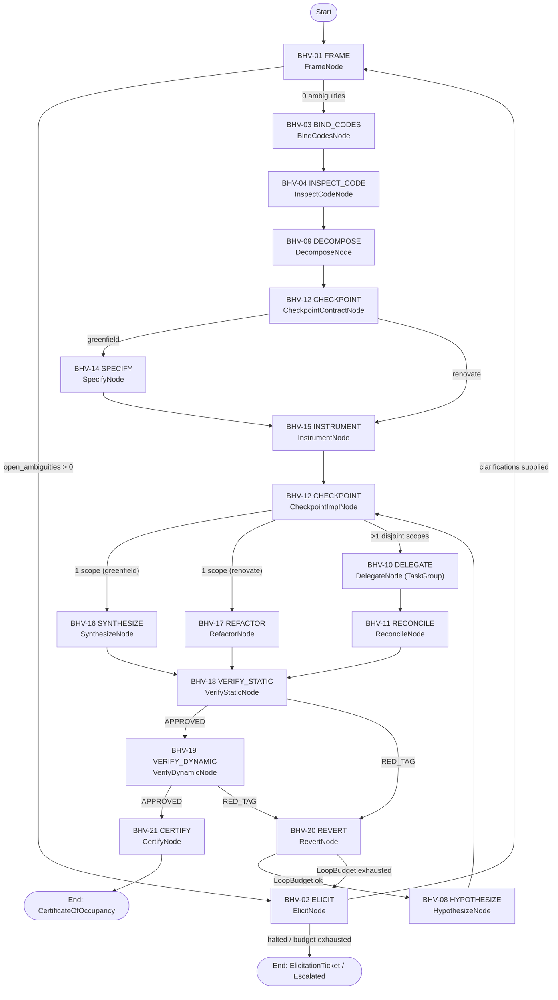

# Permit-and-Contract Engineering: Licensure-Grade Software Building Codes, Behavioral Control-Flow Verification, and Empirical Evaluation of Coding Agents

**Framework:** `jezz` (`v0.1.0` — `JBC` Edition 1.2 / `PCE` Runtime v1.3)  
**Runtime Target:** Python 3.14, `pydantic` v2.14+, `pydantic-ai` & `pydantic-graph` v2.71+, `icontract`, `Hypothesis`

---

## Abstract

Throughout 2025–2026, commercial coding-agent frameworks—most visibly GitHub `spec-kit`, Fission AI `OpenSpec`, and AWS Kiro—promoted "Spec-Driven Development" ("SDD"): a workflow that expands short user prompts into multi-file English Markdown documents (`spec.md`, `design.md`, `tasks.md`) prior to code generation and equates completion with checked-off `- [x]` task lists. We show theoretically and empirically that unverified prose specifications sever requirements from program semantics, compound assumption drift across stochastic generation hops, and launder critical defects behind human review fatigue. In response, we present **`jezz`**, a software engineering and coding-agent framework built on four pillars: (1) an atomic agent behavior basis of Fibonacci cardinality ($|\mathcal{B}| = F_8 = 21$) verified via Kildall monotone dataflow analysis over a height-5 product semi-lattice; (2) the **Jezz Software Building Code (`JBC` Edition 1.2)**, comprising 31 deterministic static, graph-theoretic, runtime-breaker, and dynamic-attestation provisions (including `JBC-SEC-006` dynamic path anchoring) with statutory sunset variances and Git-aware differential occupancy ratcheting; (3) **Permit-and-Contract Engineering (`PCE`)**, a five-phase, anti-Agile methodology requiring compiled contract grounding and SHA-256 content-addressed occupancy seals ($\mathcal{I} \models_{\text{PCE}} \mathcal{M}$); and (4) a self-hosted `pydantic-ai` and `pydantic-graph` Extended Finite-State Machine (EFSM) runtime enacting all `21 / 21` basis behaviors with least-privilege sandboxing, permit-gated `BHV-13 PROVISION` dependency management, persistent `.jezz/memory.json` memory (`BHV-07 CURATE_MEMORY`), AST-grounded topological DAG planning, 12-slot tiered specialist routing, zero-`os.environ` vault secret isolation, a read-only `stdio` Model Context Protocol (MCP) gate server, and portable `${PLUGIN_ROOT}` lifecycle `Stop` hooks. Evaluated across **7.41 million lines of brownfield Python code** (`17,609` files across 6 external repositories), **46 live controlled A/B workspace builds** (`Control: Prose SDD` vs. `Treatment: jezz PCE` across uniform `gemini-3.8-flash` and symmetric tiered `gemini-4-hydrogen` + `gemini-3.8-flash` waves), and a **4-mandate longitudinal financial crucible (`jezz-crucible-ledger`, `2,693` LOC)**, `Prose SDD` achieved `100%` (`23/23`) Markdown `- [x]` validation while producing **`0%` (`0/23`) `JBC`-occupiable builds**, **`375` unwaived violations (`36` `LIFE_SAFETY`)**, a **`56.5%` `mypy --strict` failure rate**, a **`39.1%` self-test failure rate**, and a **`17.4%` silent runtime-crash escape rate** on held-out `Hypothesis` oracles. Notably, upgrading SDD's specification architect to frontier `gemini-4-hydrogen` *degraded* downstream code safety (`+61.0%` total violations, `3.8x` more `LIFE_SAFETY` defects). Conversely, `PCE` achieved **`6/6` (`100%`) task closure** on both uniform and tiered routing, sealed all `4/4` sequential crucible mandates with `0` rollbacks, cut tiered latency by **`-48.5%`**, and maintained a **`0.0%` silent defect escape rate** (`36/36` held-out oracle checks across Waves 4B–4E).

---

## 1. Critique of Marketed "Spec-Driven Development" & Formal Lineage

### 1.1 Primary-Source Pathology Analysis

Recent vendor offerings frame multi-stage Markdown generation as a foundational "Power Inversion" in software engineering:

1. **GitHub `spec-kit` (`github/spec-kit`):** In `spec-driven.md`, `spec-kit` asserts that *"For decades, code has been king. Specifications served code—they were the scaffolding we built and then discarded... The Product Requirements Document (PRD) isn't a guide for implementation; it's the source that generates implementation."* Under the hood, `spec-kit` contains no parser, typechecker, or solver: `/speckit.specify` $\to$ `/speckit.plan` $\to$ `/speckit.tasks` $\to$ `/speckit.implement` are chat slash-prompts feeding English prose to a probabilistic model, while `.specify/memory/constitution.md` relies strictly on system-prompt compliance. Running `/speckit.implement` twice on identical Markdown yields structurally incompatible implementations with divergent types and edge-case faults—proving `spec.md` is a stochastic writing prompt, not an executable source artifact.
2. **Fission AI `OpenSpec` (`Fission-AI/OpenSpec`):** `OpenSpec` mandates RFC 2119 modals (`SHALL`/`MUST`) and Gherkin-style `#### Scenario:` (`GIVEN / WHEN / THEN`) blocks inside Markdown delta files, gated by `openspec validate --strict`. Whereas Behavior-Driven Development (North, 2006; Hellesøy, 2008) bound every `Given/When/Then` clause to executable test step definitions, `openspec validate` inspects *only Markdown heading and checkbox syntax*. An implementation containing SQL injection sinks, `except Exception: pass` blocks, and `assert True` tests passes `openspec validate --strict --archived` with exit code `0` once `- [ ]` is toggled to `- [x]`.
3. **AWS Kiro (`kiro.dev`):** Kiro institutionalizes Scrum persona user stories (`As <persona>, I want..., so that...`) paired with Rolls-Royce EARS syntax (`WHEN ... THE SYSTEM SHALL ...`; Mavin et al., 2009) across `requirements.md`, `design.md`, and `tasks.md`, supplemented by event-driven Agent Hooks. At Rolls-Royce, EARS served as a constrained pre-formal intake feeding DO-178B/C verification matrices—never a self-certifying endpoint. Kiro's Agent Hooks invoke additional non-deterministic LLM prompts on file save without formal pass/fail lattices, rollback guarantees, or protection against an agent weakening tests to match defective code.

### 1.2 Historical Erasure & The Economic Unlock Paradox

Conflating informal PRDs with "specifications" omits 55+ years of formal software engineering: Floyd–Hoare axiomatic semantics $\{P\}\ C\ \{Q\}$ (1967–1969), Parnas's tabular avionics specifications and information-hiding modules (1972–1977), Z and VDM state schemas (1977–1978), Meyer's **Design by Contract** (`require`, `ensure`, `invariant` compiled directly into Eiffel, 1986–1997), Lamport's **TLA+** (1999—used in production at AWS itself to verify S3 and DynamoDB; Newcombe et al., *CACM* 2015), Claessen & Hughes's **QuickCheck** property-based falsification ($\forall x \in D: P(f(x))$, 2000), Jackson's **Alloy** (2002), and SMT-backed verifiers (**SPARK Ada**, **Dafny**, **Frama-C**).

Historically, formal contracts and property generators saw limited mainstream adoption for a single economic reason: **human authoring cost under schedule pressure**. Coding agents collapse the marginal cost of authoring strict domain types, preconditions/postconditions, and property-based generators toward zero—and agents converge reliably when constrained by deterministic compiler/AST feedback. Using LLMs to mass-produce 1990s prose PRDs and Agile checklists squanders that exact economic unlock.

### 1.3 Multi-Hop Stochastic Drift & Specification Laundering

Marketed SDD interposes a four-hop unverified natural-language chain between human intent $I_0$ and executable code $C_{\text{code}}$:

$$I_0 \xrightarrow{\text{LLM}} S_{\text{prose}} \xrightarrow{\text{LLM}} D_{\text{prose}} \xrightarrow{\text{LLM}} T_{\text{prose}} \xrightarrow{\text{LLM}} C_{\text{code}}$$

By the Data Processing Inequality, $I(I_0; T_{\text{prose}}) \le I(I_0; S_{\text{prose}})$: ungrounded prose-to-prose transformations cannot increase mutual information with $I_0$; each hop either discards boundary precision or injects unverified assumptions $\epsilon_k$ (at $90\%$ per-hop assumption fidelity, $0.90^4 = 65.6\%$). Simultaneously, inflating a 40-word prompt into 400–700 lines of repetitive Markdown induces **Specification Laundering**: human reviewers suffer review fatigue (documented independently by Böckeler, 2025) and rubber-stamp *Approve*, converting LLM hallucinations into the project's nominal specification.

---

## 2. Pillar 1: The $F_8 = 21$ Agent Behavior Basis & CFG Dominance

### 2.1 Basis Separation and State Algebra

`jezz` separates **atomic agent behaviors** from both low-level **tools** (`read_file`, `grep`, `git`, `pytest`, MCP calls—which are interchangeable sensors/actuators) and high-level **workflows** ("fix bug", "renovate module"—which are composite directed graphs over atomic behaviors).

Every atomic behavior $b \in \mathcal{B}$ denotes a typed state-transition contract over the four-domain product state space (`AgentExecutionState` in `src/jezz/behaviors/runtime.py`):

$$\Sigma = \mathcal{P} \times \mathcal{W} \times \Omega \times \mathcal{E}$$

where $\mathcal{P}$ (`ProblemState`) holds framed objectives, ambiguities, bound code IDs, and decomposed scopes; $\mathcal{W}$ (`WorldModelState`) holds grounded code/environment/external observations, causal hypotheses, active delegations, and negative knowledge (`falsified_paths`); $\Omega$ (`WorkspaceState`) tracks checkpoints, modified artifacts, and sealed commits; and $\mathcal{E}$ (`EvidenceState`) records static/dynamic gate verdicts and occupancy certification.

The basis cardinality is constrained to the eighth Fibonacci number, $|\mathcal{B}| = F_8 = 21$, partitioned across five strata (`3 + 4 + 4 + 6 + 4 = 21`):
- **Stratum I — Governance (3):** `BHV-01 FRAME`, `BHV-02 ELICIT`, `BHV-03 BIND_CODES`
- **Stratum II — Epistemic (4):** `BHV-04 INSPECT_CODE`, `BHV-05 INSPECT_ENV`, `BHV-06 CONSULT`, `BHV-07 CURATE_MEMORY`
- **Stratum III — Topology (4):** `BHV-08 HYPOTHESIZE`, `BHV-09 DECOMPOSE`, `BHV-10 DELEGATE`, `BHV-11 RECONCILE`
- **Stratum IV — Mutation (6):** `BHV-12 CHECKPOINT`, `BHV-13 PROVISION`, `BHV-14 SPECIFY`, `BHV-15 INSTRUMENT`, `BHV-16 SYNTHESIZE`, `BHV-17 REFACTOR`
- **Stratum V — Verification (4):** `BHV-18 VERIFY_STATIC`, `BHV-19 VERIFY_DYNAMIC`, `BHV-20 REVERT`, `BHV-21 CERTIFY`

### 2.2 Why a Fibonacci Cardinality Constraint? (Anti-Accretion Quantization)

Constraining $|\mathcal{B}| \in \mathcal{F}$ (enforced at import and test time via Gessel's algebraic criterion $5n^2 \pm 4 = k^2$ in `src/jezz/behaviors/fibonacci.py` and `validate_basis_invariants` in `taxonomy.py`; Gessel, 1972) is **not** a claim that coding agents possess a metaphysical attachment to the golden ratio—nor has it anything to do with Agile story-point rituals. It is a **machine-checked anti-accretion and resolution-quantization lock** designed to defeat the primary failure mode of agent taxonomies: **$+1$ enum creep**.

In unconstrained frameworks, every new tool integration or domain workflow tempts authors to append a 22nd, 23rd, or 24th "behavior" (`run_linter`, `query_db`, `open_pr`), conflating *actuators* and *composite workflows* with *state-algebra primitives*. A static arbitrary cap (e.g., $\le 25$) still permits $+1$ drift up to the ceiling without structural pressure. Requiring $|\mathcal{B}| \in \{8, 13, 21, 34, 55, \dots\}$ imposes **discrete geometric resolution steps** spaced by $\varphi \approx 1.618\times$:
1. **Blocking Ad-Hoc $+1$ Drift:** Adding a single 22nd enum member immediately breaks `validate_basis_invariants`. To handle a proposed capability at $|\mathcal{B}| = 21$, an author is forced to either (a) **prove composite reducibility** by expressing it as a directed subgraph over existing basis behaviors, (b) **merge redundant behaviors** with identical $(\text{reads}, \text{writes}, \text{effect})$ signatures, or (c) **justify a full resolution jump** ($21 \to 34$, $+13$ orthogonal state transitions across $\Sigma$).
2. **Sub-Doubling Granularity Over Powers of Two ($2^k$):** Powers of two ($8, 16, 32$) double at every step—leaving a $+16$ cliff where $16$ is too coarse to separate governance, epistemic, topology, mutation, and verification contracts while $32$ invites tool-modality leakage. Fibonacci's $\varphi \approx 1.618$ recurrence provides the canonical integer sequence with sub-doubling spacing, cleanly bracketing the abstraction boundary: at $F_7 = 13$, distinct mutation contracts (`SPECIFY`, `INSTRUMENT`, `SYNTHESIZE`, `REFACTOR`) collapse into generic file editing (making Phase III-before-Phase IV ordering unenforceable on the graph), whereas at $F_9 = 34$, sensor/actuator mechanics leak into $\mathcal{B}$.

### 2.3 Pointed Labeled Control-Flow Graphs & Co-Reachability

A coding-agent task topology is a pointed, vertex-labeled directed graph (`BehaviorGraph` in `src/jezz/behaviors/graph.py`):

$$G = (V, E, \ell, v_0), \quad E \subseteq V \times V, \quad \ell: V \to \mathcal{B}, \quad v_0 \in V$$

Let $\Delta \subseteq \mathcal{B} \times \mathcal{B}$ denote the statutory 1-hop transition relation (`ALLOWED_TRANSITIONS` in `src/jezz/behaviors/transitions.py`). Structural legality requires:
1. **Unique Entry & Local Adjacency:** $\ell(v_0) = \text{FRAME}$, $(v, v) \notin E$ (no self-loops), and $\forall (u, v) \in E: (\ell(u), \ell(v)) \in \Delta$. In particular, $\Delta$ forbids direct transitions from any mutating behavior $M_{\text{mut}} = \{\text{PROVISION}, \text{SPECIFY}, \text{INSTRUMENT}, \text{SYNTHESIZE}, \text{REFACTOR}\}$ to $\{\text{CERTIFY}, \text{ELICIT}, \text{FRAME}\}$, requires $\text{ELICIT}$ to re-enter strictly via $\text{FRAME}$, makes $\text{CERTIFY}$ an absorbing sink ($\Delta(\text{CERTIFY}) = \emptyset$), and forbids blind retry ($\Delta(\text{REVERT}) \cap (M_{\text{mut}} \cup \{\text{CHECKPOINT}\}) = \emptyset$).
2. **Forward Reachability & Backward Co-Reachability:** Let $R \subseteq V$ be the vertices reachable from $v_0$, and let $S = \{v \in R \mid \deg^+(v) = 0\}$ be the reachable sinks. Every sink must satisfy $\ell(v) \in \{\text{CERTIFY}, \text{ELICIT}\}$, and **every reachable vertex must be co-reachable from $S$** ($R = \text{Pre}^*(S) \cap R$). This rules out livelock trap cycles (e.g., an infinite `VERIFY_STATIC -> REVERT -> HYPOTHESIZE -> SYNTHESIZE` loop with no escape edge to `CERTIFY` or `ELICIT`).

### 2.4 Kildall Monotone Dataflow Verification on a Height-5 Lattice

Local 1-hop legality $(\ell(u), \ell(v)) \in \Delta$ is necessary but insufficient: a multi-hop path could enter `SYNTHESIZE` without ever executing `BIND_CODES` or `CHECKPOINT`, or branch around `VERIFY_DYNAMIC` into `CERTIFY`. Because valid agent workflows contain directed cycles (authority elicitation loops and bounded `REVERT -> HYPOTHESIZE` remediation loops), `verify_behavior_graph` solves a monotone dataflow system (Kildall, 1973) over the finite-height product semi-lattice (`NodeFlowFacts`):

$$L = \underbrace{(\{0, 1\}^2, \wedge)}_{\text{MUST dominance}} \times \underbrace{(\{0, 1\}^3, \vee)}_{\text{MAY hazard taint}}$$

Each element $x = (c, k, d_s, d_d, u) \in L$ tracks five boolean flow facts at node entry/exit, ordered componentwise by the confluence operator $\sqcap: L \times L \to L$:

$$x \sqcap y = (c \wedge c',\ k \wedge k',\ d_s \vee d_s',\ d_d \vee d_d',\ u \vee u')$$

with unvisited identity $\top = (\text{True}, \text{True}, \text{False}, \text{False}, \text{False})$ and entry seed $x_{\text{init}} = (\text{False}, \text{False}, \text{False}, \text{False}, \text{False})$:
- $c$ (`codes_bound`, `MUST`): set to $\text{True}$ by `BIND_CODES`; required ($c = \text{True}$) at entry to $M_{\text{mut}} \cup \{\text{DELEGATE}, \text{CERTIFY}\}$.
- $k$ (`checkpoint_active`, `MUST`): set to $\text{True}$ by `CHECKPOINT`; required ($k = \text{True}$) at entry to $M_{\text{mut}} \cup \{\text{REVERT}\}$.
- $d_s$ (`may_be_dirty_static`, `MAY`): set to $\text{True}$ by $\{\text{SPECIFY}, \text{INSTRUMENT}, \text{SYNTHESIZE}, \text{REFACTOR}\}$; cleared to $\text{False}$ by $\{\text{VERIFY\_STATIC}, \text{REVERT}\}$; must be $\text{False}$ at `CERTIFY`.
- $d_d$ (`may_be_dirty_dynamic`, `MAY`): set to $\text{True}$ by $\{\text{PROVISION}, \text{INSTRUMENT}, \text{SYNTHESIZE}, \text{REFACTOR}\}$; cleared to $\text{False}$ by $\{\text{VERIFY\_DYNAMIC}, \text{REVERT}\}$; must be $\text{False}$ at `CERTIFY`.
- $u$ (`unreconciled_delegation`, `MAY`): set to $\text{True}$ by `DELEGATE`; cleared to $\text{False}$ by `RECONCILE`; must be $\text{False}$ at `CERTIFY`.

**Proposition 1 (Fixed-Point Convergence & Linear Complexity):** *Each per-behavior transfer function $f_b: L \to L$ (`_transfer_facts`) is a constant-set, constant-clear, or identity map on each independent coordinate, and is therefore monotone ($x \sqsubseteq y \implies f_b(x) \sqsubseteq f_b(y)$) and distributive ($f_b(x \sqcap y) = f_b(x) \sqcap f_b(y)$). Because $L$ has finite height $h(L) = 5$, each reachable vertex $v \in R$ can descend the lattice at most $5$ times from $\top$, so worklist iteration converges to the exact Meet-Over-All-Paths (MOP) solution in at most $5|R|$ node updates and $\mathcal{O}(|V| + |E|)$ edge evaluations.*

---

## 3. Pillar 2: The Jezz Software Building Code (`JBC` Edition 1.2)

### 3.1 Statutory Architecture & Severity Taxonomy

Civil and electrical codes (NFPA 70 / NEC, IBC) recognize that happy-path energization ("the lamp turns on") does not establish safety: an ungrounded chassis or bypassed breaker operates normally until a fault occurs. Existing software standards leave an enforcement gap: ISO/IEC 25010 and IEEE 1016/29148 define non-decidable quality nouns, MITRE CWE catalogs ~900 post-mortem weaknesses rather than affirmative construction rules, and pre-LLM standards omit agentic failure modes—tautological assertions (`AGT-THEATRE-01`), hollow stubs (`AGT-STUB-01`), hallucinated/undeclared imports (`AGT-HALLUC-01`), `# type: ignore` / `# noqa` gate tampering (`AGT-TAMPER-01`), and hardcoded machine-local paths (`AGT-PATH-01`).

`JBC` Edition 1.2 (`src/jezz/codes/codebook.py`) codifies **31 machine-checkable provisions across 6 Articles**, each classified into three statutory severities (`8 + 17 + 6 = 31`):
- **`LIFE_SAFETY` (8 provisions — strictly non-waivable):** Silent fault suppression (`JBC-FLT-001`), dynamic SQL/shell/eval injection (`JBC-SEC-001`), credential leakage (`JBC-SEC-002`), uncontained path/URL sinks (`JBC-SEC-005`), tautological/assertion-free tests (`JBC-VRF-001`), hollow stubs (`JBC-VRF-002`), and failed static/dynamic gate attestations (`JBC-VRF-005`, `JBC-VRF-006`). Attempting to instantiate a `CodeVariance` against any `LIFE_SAFETY` code raises `ValueError` at model construction.
- **`STRUCTURAL` (17 provisions):** Preconditions/postconditions (`JBC-DBC-001`), 100% static annotations & `Any` ban (`JBC-DBC-002`), total explicit return paths (`JBC-DBC-003`), `@jezz_callable` Option A public runtime signature breakers (`JBC-DBC-004`), bounded scalars/collections (`JBC-DBC-005`), causal `raise ... from exc` chaining (`JBC-FLT-002`), managed handles & sync timeouts (`JBC-FLT-003`), `LoopBudget` / fuel-bounded recursion (`JBC-FLT-004`), `TaskGroup` & async deadlines (`JBC-FLT-005`), bounded caches & `read_bounded_text` (`JBC-FLT-006`), `STRICT_FROZEN_CONFIG` closed schemas (`JBC-SEC-003`), typed JSON ingress/egress (`JBC-SEC-004`), dynamic path anchoring & hardcoded host/OS path prohibition (`JBC-SEC-006`), acyclic module topology & `_private` enclosures (`JBC-COG-003`), immutable defaults (`JBC-OBS-002`), manifest dependency grounding (`JBC-VRF-003`), and suppression bans (`JBC-VRF-004`).
- **`WORKMANSHIP` (6 provisions):** Cognitive Complexity $\le 15$ (`JBC-COG-001`, tightened to $\le 10$ in internal `jezz` profiles), nesting $\le 4$ / arity $\le 6$ / span $\le 35$ statements (`JBC-COG-002`), table-driven `MappingProxyType` dispatch with $\le 1$ `elif` (`JBC-COG-004`), single-duty class cohesion (`JBC-COG-005`), structured telemetry & `print()`/debugger bans (`JBC-OBS-001`), and deterministic clock/PRNG injection (`JBC-OBS-003`).

### 3.2 Graph-Theoretic AST Lifts: `LCOM4` Cohesion & Differential SCC Ratcheting

Beyond local AST visitors, `BuildingInspector` lifts Python syntax trees into two graph structures:

#### A. Undirected Method–Attribute Intersection Graph (`JBC-COG-005`)
To replace subjective "Single Responsibility Principle" prose with a decidable graph invariant (`src/jezz/codes/cohesion.py`), each non-schema class $C$ with non-exempt instance methods $M_C$ and written instance attributes $A_C$ induces an undirected graph $G_{\text{cls}} = (M_C, E_{\text{cls}})$. Each method $m \in M_C$ has an accessed field footprint $F(m) \subseteq A_C$ and intra-class call set $\text{Calls}(m) \subseteq M_C$. An undirected edge $\{m_i, m_j\} \in E_{\text{cls}}$ exists iff:

$$(F(m_i) \cap F(m_j) \neq \emptyset) \;\lor\; (m_j \in \text{Calls}(m_i)) \;\lor\; (m_i \in \text{Calls}(m_j))$$

Following Hitz & Montazeri (1995), $\text{LCOM4}(C) = b_0(G_{\text{cls}})$ (the number of connected components of $G_{\text{cls}}$). `JBC-COG-005` mandates $\text{LCOM4}(C) \le 1$, zero stateless instance methods ($F(m) = \emptyset \land \text{Calls}(m) = \emptyset$), $|A_C| \le 5$, $|M_C^{\text{pub}}| \le 7$, and weighted methods per class $\text{WMC}(C) = \sum_{m \in M_C} (1 + \text{CC}(m)) \le 35$. Whenever $\text{LCOM4}(C) \ge 2$, $C$ provably bundles disconnected state machines that split cleanly along connected-component boundaries.

#### B. Module Dependency SCCs & Differential Subgraph Soundness (`JBC-COG-003` & `ratchet.py`)
Workspace modules $M$ and resolved intra-workspace imports $E_{\text{imp}} \subseteq M \times M$ form a directed dependency graph $G_{\text{mod}} = (M, E_{\text{imp}})$. `JBC-COG-003` decomposes $G_{\text{mod}}$ into Strongly Connected Components $\text{SCC}(G_{\text{mod}})$ in $\mathcal{O}(|M| + |E_{\text{imp}}|)$ time via an iterative, `LoopBudget`-guarded Tarjan algorithm (`src/jezz/codes/rules_cog.py`), flagging any $C \in \text{SCC}(G_{\text{mod}})$ with $|C| > 1$ or a self-edge.

For brownfield CI adoption, the **Differential Occupancy Ratchet** (`jezz inspect --changed-since <ref>` / `--staged` in `src/jezz/codes/ratchet.py`) gates only modified or untracked files $M_\Delta \subseteq M$. Naive differential linters restrict analysis to the **induced subgraph** $G_{\text{mod}}[M_\Delta]$, which is **unsound** for cycle detection: if a legacy module $\alpha \in M \setminus M_\Delta$ already imports $\zeta \in M_\Delta$, and a pull request edits $\zeta$ to import $\alpha$, the cycle $(\alpha \to \zeta \to \alpha)$ has $E(G_{\text{mod}}[M_\Delta]) = \emptyset$ and goes undetected. Furthermore, anchoring the citation on the lexicographically first member $\min(C) = \alpha$ would discard the finding under a post-hoc `finding.file in M_Δ` filter. `check_cog_003_for_paths` preserves soundness by computing $\text{SCC}(G_{\text{mod}})$ over the **entire** workspace $M$, retaining every nontrivial component $C$ satisfying $C \cap M_\Delta \neq \emptyset$, and anchoring the `SourceSpan` on the first touched member in $C \cap M_\Delta$.

### 3.3 Sunset Variances (`expires_on`) & Content-Addressed Occupancy Seals

To prevent temporary brownfield waivers from calcifying into permanent `# noqa` debt, `CodeVariance` (`src/jezz/codes/permits.py`) supports an ISO-8601 `expires_on: date | None` deadline evaluated deterministically against `reference_date` (`--as-of YYYY-MM-DD`, defaulting to UTC today). While `reference_date <= expires_on`, matching findings record `VARIANCE_WAIVED` (`APPROVED_WITH_VARIANCES`); on `reference_date > expires_on`, `BuildingInspector` automatically flips the finding back to `VIOLATION` (`RED_TAG`) with `[Expired variance '<id>' (sunset YYYY-MM-DD)]`.

When an `InspectionReport` achieves zero unwaived violations, `issue_certificate` binds the ruling to a deterministic workspace content digest (`compute_units_digest`: sorted `file_path \x00 source \x00` bytes) via `inspector_seal = "sha256:" + SHA256(permit_id | ruling | cited_code_ids | exercised_variance_ids | artifact_digest)`. Strictly, `CertificateOfOccupancy` is an **unkeyed SHA-256 hash commitment** (rendering any post-certification edit to `src/`, `tests/`, or `permit_id` immediately detectable as `INVALID_OCCUPANCY_SEAL` during `audit_pce_dossier`), rather than a keyed HMAC or asymmetric PKI signature; untrusted-actor non-repudiation is enforced by re-executing `BuildingInspector` in CI (`.github/workflows/jbc-gate.yml`).

---

## 4. Pillar 3 & Pillar 4: Permit-and-Contract Engineering (`PCE`) & Runtime Architecture

### 4.1 The Five Statutory Phases and the Occupancy Relation ($\mathcal{I} \models_{\text{PCE}} \mathcal{M}$)

**Permit-and-Contract Engineering (`PCE`)** replaces Agile user stories and unverified prose specs with five gated phases (`src/jezz/methodology/`):
1. **Phase I — `MANDATE` (`FRAME` / `ELICIT`):** Encodes a compact (~35–48 line) `EngineeringMandate` rejecting persona user stories, `- [ ]` checkboxes, and weasel modals (`should`, `might`, `ideally`). Non-empty `open_ambiguities` force an immediate authority halt at `BHV-02 ELICIT`. Target files are partitioned into pairwise-disjoint `ModuleWriteScope`s ($S_i \cap S_j = \emptyset$ for $i \neq j$).
2. **Phase II — `PERMIT` (`BIND_CODES` / `INSPECT_CODE` / `DECOMPOSE`):** Locks a `CodePermit` binding `CodeTrigger.UNIVERSAL` plus auto-detected hazard triggers across all 31 `JBC` provisions, inspects `WorkspaceAstGraph`, and computes topological `ModuleWriteScope.depends_on` execution waves (`compute_scope_execution_waves`).
3. **Phase III — `CONTRACT` (`CHECKPOINT` / `SPECIFY` / `INSTRUMENT`):** Encodes executable `STRICT_FROZEN_CONFIG` Pydantic models, `@icontract` predicates, and `pytest` + `Hypothesis` falsification suites on disk prior to implementation, locking a pre-implementation snapshot (`checkpoint_impl`).
4. **Phase IV — `CONSTRUCTION` (`SYNTHESIZE` / `REFACTOR` / `DELEGATE` + `RECONCILE`):** Synthesizes greenfield modules, renovates brownfield modules (`jezz renovate`), or dispatches parallel `asyncio.TaskGroup` workers confined to scoped `WorkspaceSandbox` views.
5. **Phase V — `OCCUPANCY` (`VERIFY_STATIC` / `VERIFY_DYNAMIC` / `REVERT` / `CERTIFY`):** Evaluates Rough-In AST/graph inspection and Final subprocess `mypy --strict` + `pytest` watchdogs. Any `RED_TAG` triggers `BHV-20 REVERT` (restoring `checkpoint_impl` and recording negative knowledge in `falsified_paths`) followed by mandatory `BHV-08 HYPOTHESIZE` causal diagnosis. Passing both gates seals a SHA-256 `CertificateOfOccupancy` and audits the complete `EngineeringDossier` (`audit_pce_dossier`), verifying: (i) zero open ambiguities, (ii) Kildall `BehaviorGraph` validity, (iii) contract-before-synthesis ordering, (iv) write-scope confinement, (v) 100% AST symbol grounding of every `DomainInvariant.verification_symbol`, and (vi) `CertificateOfOccupancy` digest integrity.

### 4.2 Macro Control-Flow Graph vs. Micro Artifact ASTs (`pydantic-graph` EFSM)

`PceWorkflowOrchestrator` (`src/jezz/agents/orchestrator.py`) implements a **two-scale compiler architecture**:
- **Macro-Scale Agent EFSM (`pydantic-graph`):** `build_pce_workflow_graph()` compiles 22 `AtomicBehaviorGraphNode` dataclasses (`src/jezz/agents/nodes.py`, spanning all `21 / 21` `BehaviorKind`s verified by `validate_runtime_node_coverage()`) via `GraphBuilder.add_reachable(FrameNode)`. Each node's `run()` return annotation (e.g., `VerifyStaticNode.run(...) -> VerifyDynamicNode | RevertNode`) serves simultaneously as a **static Python AST node** checked by `mypy --strict` and as **runtime type metadata** reflected via `typing.get_type_hints` to synthesize directed graph edges—making unverified shortcuts (`SynthesizeNode -> CertifyNode`) or blind retries (`RevertNode -> SynthesizeNode`) unrepresentable in the type system.
- **Micro-Scale Artifact ASTs (`SourceUnit`) & Trace Projection ($\pi$):** Mutating EFSM nodes produce Python files parsed into ASTs; verification EFSM nodes inspect those ASTs to select successor edges. At termination, `trace_to_behavior_graph` (`src/jezz/behaviors/runtime.py`) projects the observed EFSM walk $\tau = (s_1, \dots, s_m)$ into its induced `BehaviorGraph` $\pi(\tau) = G_\tau$ and discharges global dominance invariants via `verify_behavior_graph(G_\tau)`.

### 4.3 Specialist Routing, Vault Isolation, MCP Gate, & Lifecycle Hooks

- **Role-Tiered Specialist Routing (`src/jezz/agents/routing.py`):** Maps `[tool.jezz.models]` and CLI tier overrides (`--architect-model` for `FRAME`/`DECOMPOSE`/`SPECIFY`/`HYPOTHESIZE`, `--builder-model` for `INSTRUMENT`/`SYNTHESIZE`/`REFACTOR`, `--inspector-model` for `INSPECT_CODE`) onto all 8 `PceModelSuite` slots, stamping exact `model_id` provenance in `AgentInvocationTelemetry` and wrapping network calls in per-request `TlsResilientModel` contexts to eliminate idle keep-alive TLS record faults.
- **Zero-`os.environ` Secret Hygiene (`src/jezz/secrets.py`):** Resolves per-provider API credentials once per provider family from Proton Pass CLI (`pass-cli item view pass://...`) into `pydantic.SecretStr` with `PROTON_PASS_AGENT_REASON` audit logging, never mutating process `os.environ` (`JBC-SEC-002`, `JBC-OBS-003`) and blocking cross-provider `--api-key-uri` sharing.
- **Statutory `stdio` MCP Server & Portable `Stop` Gate (`src/jezz/mcp_server.py`, `src/jezz/hooks.py`, `src/jezz/plugin.py`):** Decouples Pillars 1–3 from the batch orchestrator so interactive external agents (Antigravity, Claude Code, Cursor, JetBrains AI) can invoke 8 read-only tools—`jbc_preview_source`, `jbc_inspect_differential`, `jbc_inspect_workspace`, `jbc_query_ast_graph`, `jbc_list_codes`, `jbc_get_code`, `jbc_verify_behavior_graph`, and `jbc_audit_dossier`—under a `ContainedPath` root jail (`JBC-SEC-005`). `jezz init` installs a zero-hardcoded-path `.agents/plugins/jezz/` bundle anchored dynamically via `${PLUGIN_ROOT}` (`JBC-SEC-006`) whose `jezz hook stop` gate blocks turn completion (`"decision": "continue"`) whenever modified Python files contain unwaived `JBC` v1.2 `RED_TAG` or `SYNTAX_ERROR` findings.

---

## 5. Empirical Evaluation

### 5.1 Brownfield Field Trial: 7.41M LOC Across Six External Repositories (Track 2)

To validate `BuildingInspector` precision, throughput, and failure-mode coverage at zero LLM token cost, `jezz inspect` evaluated **17,609 Python files (`7,414,726` LOC)** across six repositories (`docs/track-2-brownfield-field-trial.md`):

| Repository | Domain | Units (Prod / Test) | Total LOC | Key True-Positive `JBC` v1.1 Findings |
| :--- | :--- | ---: | ---: | :--- |
| **GitHub `spec-kit`** | Flagship "SDD" CLI | `699` (`308` / `391`) | `291,626` | `4` `shell=True`/`exec()` sinks (`SEC-001`), `161` silent `except: pass` (`FLT-001`, incl. `_download_security.py`), `11` implicit `None` fallthroughs (`DBC-003`), `341` timeout-free `subprocess.run` (`FLT-003`), `WMC = 395` God class (`COG-005`). |
| **`kirodotdev/KiroCrew`** | Kiro Python agent runtime | `13,426` (`4,588` / `8,838`) | `6,800,169` | `3,864` silent `except: pass` (`FLT-001`), `5,362` unstructured `ensure_future`/`create_task` spawns (`FLT-005`), `5,705` zero-assertion smoke tests (`VRF-001`), `22,921` `# noqa`/`# type: ignore` directives (`VRF-004`), `326` f-string SQL queries (`SEC-001`). |
| **AWS Kiro E2E Sample** | Official Kiro SDD showcase | `10` (`10` / `0`) | `2,751` | **`0` test files**, `25` untyped `json.load()` (`SEC-004`), `51` uncontained path sinks (`SEC-005`), silent `except: pass` (`FLT-001`), undeclared `jsonschema` import (`VRF-003`) with no manifest. |
| **`pydantic`** | Core validation library | `3,162` (`67` / `3,095`) | `225,134` | Inspected in `15.85s` (`0` crashes on metaclass machinery); caught `yaml.load` without `SafeLoader` in docs plugin (`SEC-001`), timeout-free `check_output`/`requests.get` (`FLT-003`), unchained validator raises (`FLT-002`). |
| **`pydantic-graph`** | Typed EFSM library | `14` (`14` / `0`) | `4,715` | **`0` violations** across all `SEC`, `OBS`, `DBC-001`, and `FLT-003` provisions; verified brownfield `CodePermit` variance onboarding (`APPROVED_WITH_VARIANCES`). |
| **`pydantic-deepagents`** | Multi-agent TUI harness | `298` (`214` / `84`) | `90,331` | `Popen(..., shell=True)` (`SEC-001`), uncontained `rmtree` (`SEC-005`), `46` fire-and-forget tasks (`FLT-005`), `44` undeclared imports (`VRF-003`), 45-arg `CC = 104` function (`COG-001`/`002`). |

Empirical stress-testing across this corpus drove 11 permanent analyzer calibrations—including replacing $\mathcal{O}(V(V+E))$ cycle search with $\mathcal{O}(V+E)$ iterative Tarjan SCCs for `13,426`-module repositories, PEP 621 optional-extra + `setup.cfg` manifest parsing, `ast.NodeVisitor` hook exemptions, and pathlib `/` division disambiguation. Self-hosted against `jezz` itself (`65` Python units, `143` unit/async/`Hypothesis` tests), `BuildingInspector` certifies **`APPROVED` across all `31` Edition `1.2` provisions with `0` violations and `0` variances**.

### 5.2 Live Occupancy Probes (Track 3)

Before controlled A/B benchmarking, three live probes on `google:gemini-3.8-flash` with `UvSubprocessGateRunner` (`docs/track-3-live-occupancy-trial.md`) verified: (1) **Ambiguity Dominance (`Probe 3A`):** an under-determined prompt (`"Implement a retryable webhook delivery service"`) surfaced 4 concrete domain blockers and halted cleanly at `FRAME -> ELICIT` with `0` disk writes; (2) **Adversarial Integer-Cent Synthesis (`Probe 3B`):** 4-tier basis-point settlement synthesized `MappingProxyType` dispatch (`0` `elif`s) and exact integer-cent conservation (`0/30` `JBC` violations, `sha256:739814a0...`); and (3) **3-Worker Parallel `TaskGroup` Construction (`Probe 3C`):** 3 disjoint `ModuleWriteScope`s converged concurrently via `DELEGATE -> RECONCILE` with zero cross-module signature mismatches (`sha256:5cf5aad1...`).

### 5.3 Controlled `pydantic-evals` A/B Benchmark: 46 Live Workspaces (Track 4, Waves 4A–4E)

Track 4 (`src/jezz/evals/`, `docs/track-4-sdd-vs-pce-benchmark.md`) evaluates **Control: Steelmanned Prose "SDD"** (7-article `constitution.md` + 4-stage `spec.md -> design.md -> tasks.md -> code + [x]`) against **Treatment: `jezz` `PCE`** across **6 adversarial domain packages**:
- `case_01_bps_split`: Exact integer-cent basis-point allocation across IEEE-754 $>2^{53}$ precision traps and 5-tier fee schedules.
- `case_02_sql_ledger_store`: Atomic SQLite double-entry transfers under SQL injection and partial-failure rollback hazards.
- `case_03_artifact_loader`: `ContainedPath`-jailed, byte-bounded JSON plugin manifest loader rejecting `../`, outside symlinks, coercion, and extra keys.
- `case_04_workflow_topo`: Lexicographic Kahn topological planner with critical-path layering, cycle detection, and step-budget termination.
- `case_05_margin_engine`: Single-duty (`LCOM4 <= 1`) portfolio margin engine avoiding binary float threshold drift (`0.95` / `0.40`).
- `case_06_escrow_machine`: 2-scope parallel `DELEGATE` escrow state machine enforcing idempotent replay and terminal `FROZEN`/`CLOSED` locks.

Every completed workspace was graded independently by `UvWorkspaceVerifier` using `BuildingInspector.inspect_final`, `uv run mypy .` (`--strict`), the arm's own `pytest` suite, and **held-out adversarial `Hypothesis` oracle suites** (`src/jezz/evals/oracles.py`) unseen by either arm during generation. Five waves totaling **46 live workspaces** (`23` SDD + `23` `PCE`) were executed:
- **Waves 4A & 4B (`12 + 12 = 24` workspaces):** Full 6-case runs on uniform `google:gemini-3.8-flash` before and after greenfield tool/contract parity calibrations.
- **Wave 4C (`4` workspaces):** Targeted verification of Pillar 4 v1.2 staged runtime-import and PEP 695 `TypeAliasType` gates on the two `Wave 4B` fail-closed escalations (`case_04`, `case_05`) on uniform `google:gemini-3.8-flash`, achieving `2/2` (`100%`) certification and closing all `6/6` benchmark tasks.
- **Wave 4D (`12` workspaces):** Full 6-case **symmetric tiered routing trial** pairing frontier `google:gemini-4-hydrogen` (Architect: `spec.md`/`design.md`/`tasks.md` in SDD; `FRAME`/`SPECIFY`/`HYPOTHESIZE` in `PCE`) with `google:gemini-3.8-flash` (Builder: `implement` in SDD; `INSTRUMENT`/`SYNTHESIZE`/`INSPECT_CODE` in `PCE`).
- **Wave 4E (`6` workspaces under `JBC` Edition `1.2`):** Controlled hypothesis-falsification and closure probes on `case_03_artifact_loader` (`Wave 4E-1` budget-only `28 -> 36`, `Wave 4E-2` role-routed `instrument = gemini-4-hydrogen`, and `Wave 4E-3` post-calibration class-method/`TypeAliasType` introspection in `env_introspect.py`), closing `6/6` (`100%`) tasks on symmetric tiered routing (`0/31` `JBC` v1.2 violations, `CC = 0`, `3/3` oracle pass).

#### Table 1: Master A/B Results Across Uniform (`Wave 4B`), Frontier-Tiered (`Wave 4D`), and Cumulative (`Waves 4A–4E`) Runs

| Evaluation Metric | SDD (`Wave 4B` Flash, `N=6`) | `PCE` (`Wave 4B` Flash, `N=6`) | SDD (`Wave 4D` Tiered, `N=6`) | `PCE` (`Wave 4D` Tiered, `N=6`) | Cumulative SDD (`N=23`) | Cumulative `PCE` (`N=23`) |
| :--- | :---: | :---: | :---: | :---: | :---: | :---: |
| **`OpenSpec` / Kiro Markdown Valid (`[x]`)** | **`6/6` (`100%`)** | N/A | **`6/6` (`100%`)** | N/A | **`23/23` (`100%`)** | N/A |
| **`JBC` Occupiable (`0` Violations)** | `0/6` (`0%`) | **`4/6` (`66.7%`)** | `0/6` (`0%`) | **`5/6` (`83.3%`; +4E: `6/6`)** | **`0/23` (`0.0%`)** | **`15` cert. (`6/6` tasks)** |
| **Unwaived `LIFE_SAFETY` Violations** | `5` (`4/6` cases) | `3` (`0` on cert.) | **`19` (`5/6` cases)** | `1` (**`0` on cert.**) | **`36`** | `11` (**`0` on all `15` cert.**) |
| **Total Unwaived `JBC` Violations** | `82` (`13.7`/case) | `3` (`0` on cert.) | **`132` (`22.0`/case)** | `1` (**`0` on cert.**) | **`375` (`16.3`/case)** | `11` (**`0` on all `15` cert.**) |
| **Held-Out Oracle \| Certified/"Valid" Build** | `6/6` (`4A`: `3/6`) | **`4/4` (`100%`)** | `6/6` (`4C`: `1/2`) | **`5/5` (`100%`; +4E: `6/6`)** | **`19/23` (`17.4%` silent escape!)** | **`12/12` (`100%` in 4B–4E; `0%` escape)** |
| **`mypy --strict` Pass Rate** | `4/6` (`66.7%`) | `5/6` (`83.3%`) | **`1/6` (`16.7%`)** | **`6/6` (`100%`)** | `10/23` (`43.5%`) | **`21/23` (`91.3%`; `100%` cert.)** |
| **Arm Self-Tests (`pytest`) Pass Rate** | `3/6` (`50.0%`) | `4/6` (`100%` cert.) | `4/6` (`66.7%`) | **`5/6` (`100%` cert.)** | `14/23` (`60.9%`) | **`15/15` (`100%` on cert.)** |
| **Rollbacks (`RED_TAG -> REVERT`) on Certified** | N/A | `0` (`1` each in 4C) | N/A | **`0` across all `5`** | N/A | `3` total (`4C` + `4E-3`) |
| **Mean Peak Cognitive Complexity / `elif`s** | `14.33` / `4` | `4.00` / `0` | `18.33` / `1` | **`3.67` / `0`** | `15.7` / `10` | **`2.9` / `1`** |
| **Mean Human-Reviewed Spec Lines** | `603.8` | **`38.7` (`-93.6%`)** | `410.2` | **`38.7` (`-90.6%`)** | `530.8` | **`38.3` (`13.9x` smaller)** |
| **Mean LLM Requests (Certified)** | `4.3` | `41.0` | `4.0` | **`25.8` (`-37.1%`)** | `4.2` | `32.5` (4C) $\to$ **`25.8` (4D)** |
| **Mean Total Tokens per Case** | `58,564` | `417,418` | `49,233` | **`278,978` (`-33.2%`)** | `52,874` | `417,418` (4B) $\to$ **`278,978` (4D)** |
| **Mean Wall-Clock Latency per Case** | `195.1s` | `588.9s` | `148.8s` | **`303.4s` (`-48.5%`)** | `176.2s` | `588.9s` (4B) $\to$ **`303.4s` (4D)** |

### 5.4 Principal Empirical Findings & Longitudinal Crucible (Track 5)

1. **`100%` Markdown Checkbox Compliance Over Broken & Unsafe Code:** Across all `23` SDD builds, **`23/23` (`100%`)** satisfied `OpenSpec` / Kiro Markdown validation (`SHALL` modals, `GIVEN/WHEN/THEN` scenarios, and `- [x]` task completion). Yet `13/23` (`56.5%`) failed `mypy --strict`, `9/23` (`39.1%`) failed their own `pytest` suites, and `4/23` (`17.4%`) crashed on external package import (`StrEnum` metaclass crash in `case_01`, Pydantic v1/v2 `Config` + `model_config` collision in `case_06`, and `from src.<pkg>...` import path drift in `case_05`). Constitutional prompt-begging failed on `23/23` (`100%`) of SDD runs, emitting `# type: ignore` / `# noqa` suppressions, hardcoded `/tmp` and `/etc/passwd` path literals (`JBC-SEC-006`), unbounded `while` loops, uncontained `open()` sinks, dynamic SQL f-strings, and `except ...: pass` blocks.
2. **The Wave 4D Asymmetry — "Over-Specified Prose Drift" vs. "Executable Contract Leverage":**
   - **In Prose SDD, a frontier Architect made code violations *worse*:** Upgrading `spec.md`, `design.md`, and `tasks.md` from `gemini-3.8-flash` (`Wave 4B`) to `gemini-4-hydrogen` (`Wave 4D`) increased total `JBC` violations by **`+61.0%`** (`82` $\to$ `132`), increased `LIFE_SAFETY` violations **`3.8x`** (`5` $\to$ `19`), raised mean peak Cognitive Complexity from `14.33` to **`18.33`** (`CC = 35` in `case_04`), and collapsed `mypy --strict` pass rate from `66.7%` to **`16.7%` (`1/6`)**. In `case_02_sql_ledger_store`, `gemini-4-hydrogen` authored an elaborate nested savepoint/transaction narrative in `design.md`; unconstrained by AST gates, `gemini-3.8-flash` translated that prose into a `27`-complexity context manager containing `6` f-string SQL statements (`conn.execute(f"SAVEPOINT {sp_name}")`, `JBC-SEC-001`) and `4` silent `except sqlite3.Error: pass` blocks (`JBC-FLT-001`).
   - **In `jezz` `PCE`, the same frontier Architect eliminated rollbacks and halved latency:** Channeling `gemini-4-hydrogen` into **compiled Phase III Pydantic + `@icontract` contracts** certified `5/6` cases in `Wave 4D` on the **first construction pass with `0` rollbacks**, cutting mean requests by **`-37.1%`** (`41.0` $\to$ `25.8`; `case_01` certified in `13` requests), overall tokens by **`-33.2%`**, and mean wall-clock latency by **`-48.5%`** (`588.9s` $\to$ `303.4s`).
3. **Fail-Closed Soundness & Wave 4E Hypothesis Falsification (`0.0%` Silent Defect Escape):** Whenever `PCE` could not prove compliance within step budgets, `_rollback_aborted_sandbox` restored the clean pre-mutation baseline rather than shipping unverified code. In `Wave 4E`, live falsification showed that `case_03_artifact_loader`'s `Wave 4D` halt was driven neither by request caps (`Wave 4E-1`: `28 -> 36` still halted) nor by `gemini-3.8-flash` capacity (`Wave 4E-2`: routing `instrument = gemini-4-hydrogen` still halted), but by `inspect_installed_package_api` (`env_introspect.py`) omitting public class methods (`ContainedPath.from_parts`) and `TypeAliasType` definitions (`IdentifierStr`). Fixing class-method and `TypeAliasType` introspection certified `case_03` on the original symmetric tiered routing (`0/31` `JBC` v1.2 violations, `25`-line `loader.py` with `CC = 0`, `3/3` oracle pass), achieving **`6/6` (`100%`) task closure** across both uniform and tiered waves with **`0.0%` silent defect escape** (`36/36` held-out adversarial `Hypothesis` checks across Waves 4B–4E).
4. **Longitudinal Multi-Mandate Crucible (`Track 5` — `jezz-crucible-ledger`):** Across 4 sequential, interdependent mandates in a persistent financial repository (`11` units / `2,693` LOC: `domain.py` balance algebra $\to$ raw-`--prompt` savepoint SQLite `store.py` $\to$ 2-scope / 2-wave topological DAG `escrow.py` + SHA-256 `reconcile.py` $\to$ brownfield `jezz renovate` `cli.py` under live `jezz hook stop` gates; `docs/track-5-multi-mandate-crucible.md`), `jezz` sealed all `4/4` `EngineeringDossier`s with `0` unwaived `JBC` violations, `0` reverts on certified runs, and `21/21` `pytest` + `Hypothesis` and `mypy --strict` pass.

---

## 6. Threats to Validity, Cost Trade-Offs, & Limitations

1. **Token & Request Cost Asymmetry (`~5.7x–6.8x` Gross Tokens; Compressed `-61.8%` to `-65.2%` in Effective Billed Input via Track 7 Prompt Caching):** In Wave 4D (prior to cache telemetry and prefix partitioning), certified `PCE` runs averaged `334,774` gross tokens (`25.8` requests, `334.5s`) versus `49,233` tokens (`4.0` requests, `148.8s`) for open-loop SDD (and up to `1.35M` tokens on `1`-rollback boundary-heavy `case_03` in `Wave 4E-3`). The primary driver is zero pretraining exposure: `jezz.guards` (`@jezz_callable`, `LoopBudget`, `ContainedPath`) and `JBC` Edition 1.2's 31 AST rules do not appear in public LLM training corpora, so specialists refine edge cases in-context via `_tool_preview_rough_in` and `ModelRetry` turns. Tiered routing (`Wave 4D`) cut mean latency by `-48.5%` and requests by `-37.1%` vs. uniform Flash, and Track 7 (`docs/track-7-prompt-caching-and-providers.md`) empirically demonstrated across `10` live tiered Gemini builds (`Waves 7A & 7B`) that while open-loop SDD achieves **`0.0%` (`0 / 115,300`)** prefix-cache reuse, `PCE`'s canonical static `InstructionPart` ordering and shared `Mandate + Snapshots` prefix achieve **`68.7%–72.5%` live `cache_read_tokens` hit rates**, compressing `1,160,159` gross input tokens across certified builds down to **`442,664` effective billed input tokens (`-61.8%` overall; `-65.2%` on Wave 7B 2-scope `case_06`, or `~3.09x–4.46x` SDD on 1-pass runs)**; fine-tuning/distillation remains an orthogonal path to further request reduction.
2. **Fail-Closed Availability Sensitivity to Epistemic Tool Fidelity:** Because `PCE` enforces strict step caps and refuses occupancy on any unverified state, gaps in read-only introspection tools (such as `env_introspect.py` omitting class methods prior to `Wave 4E-3`) manifest immediately as visible fail-closed halts rather than silent production bugs. While fail-closed halting occasionally requires calibrating introspection fidelity, it preserves the core safety invariant: `0` unverified lines ever receive a `CertificateOfOccupancy`.
3. **Provider & Language Generalizability:** Track 2 audited `7.41M` LOC across diverse external repositories, and Track 7 (`jezz.agents.providers`, `jezz.evals.cross_provider`) proves deterministic wire/schema/cache compatibility across `448` offline `Model.prepare_request` probes spanning Google Gemini, Anthropic Claude, OpenAI (Chat & Responses), and OpenRouter across all `16` (`12` `PCE` + `4` `SDD`) agents alongside repeatable `jezz benchmark --suite` multi-provider matrix execution. Live Track 3–5 generation runs were executed on Google Gemini models (`gemini-3.8-flash` and `gemini-4-hydrogen`) across `N = 6` benchmark packages (`46` builds) plus the 4-mandate `jezz-crucible-ledger` repository; executing live multi-provider A/B waves across Anthropic Claude and OpenAI reasoning families via `jezz benchmark --suite` and porting `JBC` Edition 1.2's AST visitors to TypeScript/Rust (`tree-sitter` / `syn`) remain natural empirical extensions (Pillar 1's 21-behavior CFG verifier and Pillar 3's `PCE` dossier model are already language-agnostic).
4. **The World–Machine Boundary (Jackson, 1995):** Formal verification proves an implementation $\mathcal{I}$ satisfies its formal mandate and code book ($\mathcal{I} \models_{\text{PCE}} \mathcal{M} \wedge \text{JBC}$), not that a human's initial informal prompt captured every real-world business nuance. `PCE` narrows—but cannot mathematically abolish—this boundary via **`13.9x` specification compression** (`38.3` lines vs. `530.8` lines of SDD Markdown), mandatory `BHV-02 ELICIT` halting on open ambiguities, prompt-independent `JBC` safety laws, and `Hypothesis` counterexample search.

---

## 7. Conclusion & Technical Appendix Index

Marketed "Spec-Driven Development" mistakes the **medium of management bureaucracy** (prose PRDs, Scrum user stories, and `- [x]` task checklists) for **engineering rigor**. Empirical evaluation demonstrates that interposing multi-hundred-line Markdown specifications without executable contract bindings or deterministic building-code gates yields `0%` code-compliant occupancy and `17.4%` silent runtime-crash escapes—and that throwing a stronger frontier model at prose generation actually amplifies downstream safety violations.

**Permit-and-Contract Engineering (`PCE`)** inverts that architecture: human review is concentrated on compact, symbol-grounded mandates and authority disambiguations (`ELICIT`), frontier reasoning is channeled into **compiled contracts** (`SPECIFY`), task execution is governed by a type-checked EFSM (`pydantic-graph`) verified via Kildall dataflow analysis over an $F_8 = 21$ behavior basis, and every artifact is held to 31 licensure-grade Software Building Codes (`JBC` Edition 1.2) before a content-addressed SHA-256 `CertificateOfOccupancy` can be sealed.

### Technical Appendices & Primary Artifacts in This Repository

- **Pillar 1 Specification:** [pillar-1-behavior-basis.md](pillar-1-behavior-basis.md) (`src/jezz/behaviors/`)
- **Pillar 2 Code Book (`JBC` Edition 1.2):** [pillar-2-building-codes.md](pillar-2-building-codes.md) (`src/jezz/codes/`, `src/jezz/guards.py`)
- **Pillar 3A Forensic SDD Teardown:** [pillar-3a-sdd-teardown.md](pillar-3a-sdd-teardown.md)
- **Pillar 3B `PCE` Methodology & Dossier Auditor:** [pillar-3b-pce-methodology.md](pillar-3b-pce-methodology.md) (`src/jezz/methodology/`)
- **Pillar 4 Runtime, Routing, Secrets, MCP Gate, & Hooks:** [pillar-4-pydantic-ai-runtime.md](pillar-4-pydantic-ai-runtime.md) (`src/jezz/agents/`, `src/jezz/secrets.py`, `src/jezz/mcp_server.py`, `src/jezz/hooks.py`, `src/jezz/plugin.py`, `src/jezz/cli.py`)
- **Track 2 Brownfield Field Trial (`7.41M` LOC):** [track-2-brownfield-field-trial.md](track-2-brownfield-field-trial.md)
- **Track 3 Live Occupancy Probes:** [track-3-live-occupancy-trial.md](track-3-live-occupancy-trial.md)
- **Track 4 Controlled A/B Benchmark (`Waves 4A–4E`):** [track-4-sdd-vs-pce-benchmark.md](track-4-sdd-vs-pce-benchmark.md) (`src/jezz/evals/`)
- **Track 5 Multi-Mandate Longitudinal Crucible & `JBC` Edition `1.2`:** [track-5-multi-mandate-crucible.md](track-5-multi-mandate-crucible.md)
- **Track 6 Full $F_8 = 21$ Behavior Runtime Closure & Persistent Memory:** [track-6-full-basis-runtime.md](track-6-full-basis-runtime.md)
- **Track 7 Token Cost Compression & Cross-Provider Generalizability:** [track-7-prompt-caching-and-providers.md](track-7-prompt-caching-and-providers.md)

---

## References

1. Böckeler, B. (2025). *Understanding Spec-Driven-Development: Kiro, spec-kit, and Tessl*. MartinFowler.com.
2. Campbell, G. A. (2017). *Cognitive Complexity: A New Way of Measuring Understandability*. SonarSource White Paper.
3. Chidamber, S. R., & Kemerer, C. F. (1994). A metrics suite for object oriented design. *IEEE Transactions on Software Engineering*, 20(6), 476–493.
4. Claessen, K., & Hughes, J. (2000). QuickCheck: A lightweight tool for random testing of Haskell programs. *ACM SIGPLAN Notices (ICFP)*, 35(9), 268–279.
5. Delimarsky, D. (2025). *Spec-driven development with AI: Get started with a new open source toolkit (`github/spec-kit`)*. GitHub Blog.
6. Gessel, I. (1972). Problem H-187 (Fibonacci perfect-square characterization $5n^2 \pm 4$). *The Fibonacci Quarterly*, 10(4), 417–419.
7. Hitz, M., & Montazeri, B. (1995). Measuring coupling and cohesion in object-oriented systems. *Proceedings of the International Symposium on Applied Corporate Computing (ISACC)*.
8. Hoare, C. A. R. (1969). An axiomatic basis for computer programming. *Communications of the ACM*, 12(10), 576–580.
9. Holzmann, G. J. (2006). The power of 10: Rules for developing safety-critical code. *IEEE Computer*, 39(6), 95–97.
10. Jackson, M. (1995). *Software Requirements & Specifications: A Lexicon of Practice, Principles and Prejudices*. Addison-Wesley.
11. Kildall, G. A. (1973). A unified approach to global program optimization. *Proceedings of the 1st Annual ACM SIGACT-SIGPLAN Symposium on Principles of Programming Languages (POPL)*, 194–206.
12. Mavin, A., Wilkinson, P., Harwood, A., & Novak, M. (2009). Easy Approach to Requirements Syntax (EARS). *17th IEEE International Requirements Engineering Conference (RE)*, 317–322.
13. Meyer, B. (1997). *Object-Oriented Software Construction* (2nd ed.). Prentice Hall.
14. Newcombe, C., Rath, T., Zhang, F., Munteanu, B., Brooker, M., & Deardeuff, M. (2015). How Amazon Web Services uses formal methods. *Communications of the ACM*, 58(4), 66–73.
15. Parnas, D. L. (1972). On the criteria to be used in decomposing systems into modules. *Communications of the ACM*, 15(12), 1053–1058.
16. Tarjan, R. E. (1972). Depth-first search and linear graph algorithms. *SIAM Journal on Computing*, 1(2), 146–160.
17. Van der Aalst, W. M. P. (1998). The application of Petri nets to workflow management. *Journal of Circuits, Systems, and Computers*, 8(1), 21–66.
